# TENGRİ — Sistem Optimize Edici

<p align="center">
  <a href="LICENSE"></a>
  
  
  
  
  
  
  
  <a href="https://github.com/Memati8383/Tengri/releases"></a>
</p>

C++ ile yazılmış bir Windows sistem optimize edici. .NET yok, Electron yok, çalışma
zamanı yok — tek bir 2,1 MB yerel çalıştırılabilir dosya, DirectX 11 üzerinde çizilen
kendi monokrom arayüzüyle.

Rozetlerin tamamı bu depodan türetilir (son biri hariç — o GitHub'daki en yeni etiketi
okur): boyut derlenmiş `build\TENGRI.exe`'nin gerçek boyutu; denetim sayısı
`build.bat`'ın çalıştırdığı altı test paketinin toplamı; anahtar sayısı
`tools\make_tweak_table.ps1`'ın saydığı değer. Kaynak değiştiğinde rakam da değişmek
zorunda — rozetler süs değil kontrol noktası.

<div align="center">
  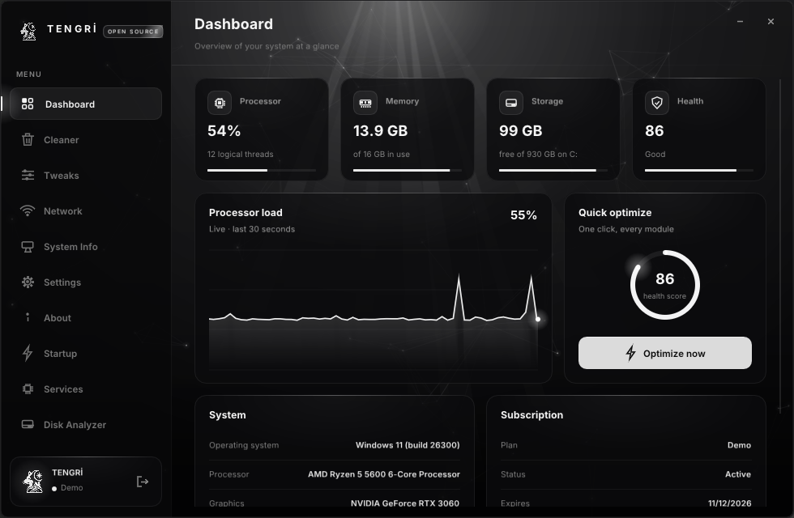
</div>

<p align="center">
  <b>10 ekran</b> · <b>92 registry anahtarı</b> · <b>10 temizlik kategorisi</b> ·
  <b>14 RAM profili</b> · <b>2 dil</b> · <b>0 telemetri</b> · <b>4 ağ çıkışı, hepsi listede</b>
</p>

Yazdığı her registry anahtarı kaynakta görünür: 80 ayarın dokunduğu 92 anahtar yolu
[docs/tweaks-registry.md](docs/tweaks-registry.md) içinde satır satır listelenir. Bu tablo kaynaktan üretilir,
elle yazılmaz. İkna dosyasına güvenmek istemiyorsan kendin derle.

<details>
<summary><b>İçindekiler</b></summary>

- [Gereksinimler](#gereksinimler)
- [Kapsam dışılar](#kapsam-dışılar)
- [Yazma kapıları](#yazma-kapıları) — her yüzeyin geçtiği sınır
- [Bilinen sınırlamalar](#bilinen-sınırlamalar)
- [Geri alma](#geri-alma)
- [İndir](#indir)
- [Kaynaktan derle](#kaynaktan-derle)
- [Ekran görüntüleri](#ekran-görüntüleri)
- [Çalıştırmadan önce](#çalıştırmadan-önce)
- [Özellikler](#özellikler) — 10 ekran, tek tek
- [Testler](#testler) — 6 paket, 938 denetim
- [Nasıl çalışıyor](#nasıl-çalışıyor)
- [Ağ kullanımı](#ağ-kullanımı) — dışarı giden dört isteğin tam listesi
- [Yükseltme](#yükseltme)
- [Derleme](#derleme)
- [Sürümleme ve kimlik](#sürümleme-ve-kimlik)
- [Mimari](#mimari) — modüller, kare döngüsü, yükseltme akışı
- [Proje yapısı](#proje-yapısı)
- [Notlar](#notlar)
- [Sürüm etiketi ve yayın](#sürüm-etiketi-ve-yayın)
- [Lisans](#lisans)

</details>

## Gereksinimler

| | |
|---|---|
| İşletim sistemi | Windows 10 ve Windows 11 (x64) |
| Mimari | 64-bit |
| Disk | 2,1 MB — içinde bulunulan kaynağın yerel derlemesi 2.139.648 bayt (`build\TENGRI.exe`, `build.bat` çıktısı). Yayınlanan CI derlemesi bundan birkaç KB farklı çıkar; kesin boyut sürüm kesiminde ölçülür ve `latest.json`da SHA-256 ile birlikte durur |
| Ek bağımlılık | Yok — .NET, Python veya çalışma zamanı gerekmez |
| Yönetici | Yalnızca ayar uygularken gerekir; açılışta gerekmez |

Windows 10 1809'dan eskisi desteklenmiyor. Bazı anahtarlar (`HwSchMode`,
`PowerThrottling`) yalnızca Windows 10 1903 ve sonrasında vardır; daha eski bir sürümde
açılıp kapatılsa bile etkisi görünmez.

## Kapsam dışılar

Bu birkaç şeyi **yapmaz**, ve yapmadığını açıkça söylemek bu aracın bir parçası:

- **Antivirüsü, güvenliği veya Windows güncellemesini değiştirmez.** Tek bir antivirüs
  ya da güvenlik özelliğini kapatmaz, hiçbir dosyayı karantinaya almaz.
- **Kendine telemetri göndermez.** Lisans ekranı bir demodur; uygulamanın kendine hiçbir
  istek yapılmaz, makine parmak izi hiçbir yere gönderilmez. Dışarı giden dört istek var:
  sürüm bildirimi, sürüm dosyasını indirme, Ağ ekranındaki gecikme ölçümü ve Medya adasının
  söz araması. İlk üçü kullanıcı verisi taşımaz. Dördüncüsü bir istisnadır ve adı konur:
  sözler açıksa (varsayılan) çalmakta olan şarkının adı/sanatçısı/albumü üçüncü taraf bir
  söz veritabanına (lrclib.net) sorulur — bu veri bize değil, o servise gider ve Ayarlar'dan
  kapatılınca hiç istek çıkmaz. Tam liste [Ağ kullanımı](#ağ-kullanımı) içinde.
- **Kendiliğinden güncellenmez.** İndirme sen "İndir" demeden başlamaz, kurulum ayrıca
  "Kur ve yeniden başlat" ister. Uygulama kapalıyken hiçbir şey inmez, hiçbir şey
  yazılmaz. Denetimin kendisi de Ayarlar → Güncellemeler altından tamamen kapatılabilir.
  (İlk çalıştırmada tek seferlik iki kayıt yazılır — bkz. [Windows bildirimleri](#windows-bildirimleri).)
- **Kullanıcı verisini okumaz.** Yalnızca [registry tablosunda](docs/tweaks-registry.md)
  listelenen anahtarlara yazar, temizleyicide de yalnızca kendi kategorilerinin saydığı
  geçici dosyaları siler. **Medya adası bu satırın birinci istisnasıdır ve adı konur:**
  aktif oynatıcının şarkı / sanatçı / album bilgisini Windows'un sistem medya oturumundan
  (GSMTC) okur — bunu ekranda göstermek ve istersen söz servisine sormak için. Ada
  kapalıyken ya da yalnızca masaüstündeyken veri toplanmaz; okunan bilgi hiçbir yere
  gönderilmez (söz araması ayrı bir kapıdır, bkz. [Ağ kullanımı](#ağ-kullanımı)).
  **Disk Analizörü ikinci istisnadır:**
  sürücünün ad alanını okur (NTFS'te `$MFT` kayıtları), çünkü "diski neyin doldurduğu"
  sorusunun başka bir yolu yok. Bu okuma tamamen yereldir, hiçbir ağ isteği taşımaz;
  sonuç `%LOCALAPPDATA%\TENGRI\diskscan.tgds` önbelleğine yazılır ve silme önerisi
  yalnızca senin seçtiğin öğeler için çıkar — sistem klasörleri listeye hiç gelmez.
- **Arka planda sessizce çalışmaz.** Ayar ancak sen "Uygula" dediğinde yazılır.

## Yazma kapıları

Her yazma isteği sisteme ulaşmadan önce bir kapıdan geçer. Kapılar koda gömülü;
`CONTRIBUTING.md`'ye yeni bir yüzey eklerken "kapısını da ekle" kuralının görsel
referansı budur.

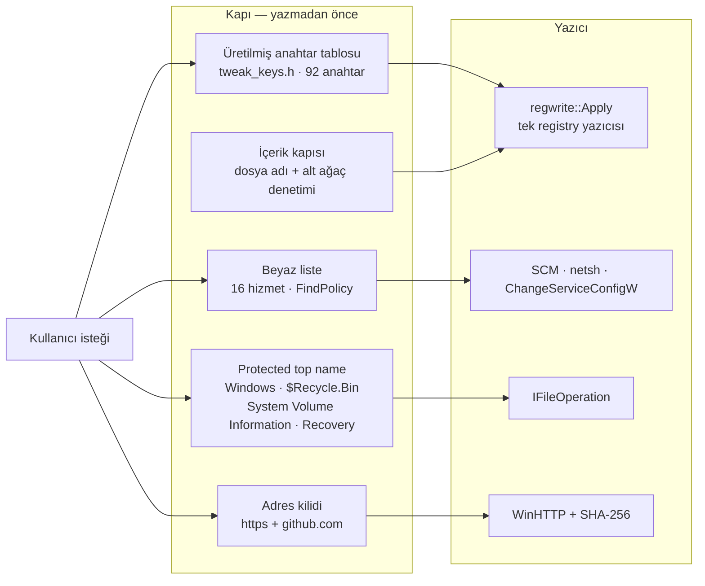

**Registry'ye yazmanın tek kapısı `regwrite::Apply`.** "Bu uygulamada registry'ye kim
yazıyor" sorusunun kod tabanında tek bir cevabı olması, kapının da tek olmasını
gerektiriyor.

| Yüzey | Kapı | Kaynak |
|---|---|---|
| İnce Ayarlar — 10 kategori, 80 ayar | Anahtar tablosu `tweak_keys.h` **derleme zamanında `tweaks.cpp` ve `regpack.cpp`'den üretilir**; elle yazılmaz. Yazma maskesi yalnızca gerçekten dokunulan satırları kapsar | `tweak_keys.h`, `regwrite.hpp` |
| Oyun profilleri (regpack) | Gövde gömülü `.reg` metnidir, **dosya değil**: `regtext::ParseRegText` bellekte çözer, `regwrite::Apply` doğrudan yazar. Süreç dışına hiçbir şey çıkmaz | `regpack.cpp`, `regwrite.hpp` |
| Yedekleme | Dışa aktarım üreticisi yalnızca **dokunulan** değerleri okur; `CREATE_NEW` ile yazar. Yedek dosyası `reg.exe` çıktısı değil, kendi üretimimizdir | `backup.cpp` |
| Geri alma | Dosya adı üretilmiş tabloda gerçek bir ayara karşılık gelmeli **ve** içindeki tüm anahtar satırları o ayarın kendi alt ağacında kalmalı. Yabancı `.reg` reddedilir | `regtext.hpp` |
| Hizmetler | `FindPolicy` — kodda sabit **16 hizmetlik** liste. Liste dışı ad arayüzde de girilemez, `SetStartType` de reddeder | `services.cpp:325` |
| Başlatma | `NeedsElevation` **işlemden önce** sorulur; deneme-yanılma yolu yok. Yedeğin hive'ı girdinin hive'ıyla aynıdır | `startup.cpp` |
| Disk Analizörü — silme | `IsProtectedTopName`: `windows`, `$recycle.bin`, `system volume information`, `recovery`. Taramanın kendi kökü de hiçbir zaman silinmez | `diskanalyzer.cpp:66` |
| Disk Analizörü — yinelenenler | 4 KB'ın altındaki dosyalar ve korumalı klasörler aday olmaz; tek başına küçük dosya "yinelenen" sayılmaz | `diskanalyzer.cpp:1759` |
| Güncelleme — indirme | `HostAllowed`: yalnızca `https` ve `github.com` / `*.githubusercontent.com`. Bildirim 1 MB, indirme 200 MB ile sınırlı | `update.cpp` |
| Alt süreçler | `syspath.hpp` — `netsh`, `ipconfig`, `powercfg`, `sc`, `srclient.dll` **yalın adla aranmaz**, tam System32 yolu verilir. Uygulamanın kendi klasörüne bırakılmış bir `netsh.exe` yönetici yetkisiyle çalıştırılamaz | `syspath.hpp` |

> **Geçici dosya yok.** Önceki sürümlerde regpack kategorileri `%TEMP%`'e bir `.reg`
> dosyası yazıp `reg.exe import` ile içe aktarıyordu. Bu yol kaldırıldı: doğrulanan
> bayt ile içe aktarılan bayt aynı yolun iki ayrı açılımıydı ve aralarına aynı kullanıcı
> bir dosya koyabilirdi. Artık çözülen kayıtlar doğrudan yazılır, dosya hiç açılmaz.

---

## Bilinen sınırlamalar

[Kapsam dışılar](#kapsam-dışılar) bölümü neyi **bilerek yapmadığını** söyler. Bu bölüm
ise uygulanan şeyin **nerede bittiğini** söyler.

| Konu | Sınır |
|---|---|
| Sistem geri yükleme noktası | `restore.cpp` derleniyor ve test ediliyor, **ama arayüzden bağlı değil** — düğmesi yok. Nokta elle oluşturulur (`sysdm.cpl` → Sistem koruma) |
| Windows sürümü | Windows 10 **1809** ve üzeri. `HwSchMode` ve `PowerThrottling` gibi anahtarlar 1903+ gerektirir; eski sürümde açılıp kapatılsa bile etki göstermez |
| Mimari | **x64.** 32-bit derleme yok |
| Yeniden başlatma | Bazı anahtarların etkili olması için yeniden başlatma gerekir; uygulama bunu izlemez, uyarı da teker teker değil genel düzeydedir |
| Başlangıç kapsamı | Yalnızca **oturum açıldığında doğrudan çalışan** kod. GPO betikleri, hizmet tetikleyicileri ve WMI abonelikleri kapsam dışı |
| Winlogon | `Shell` ve `Userinit` **salt-okunur**: sapma varsa işaretlenir, düğmeler kapalı gelir. Bkz. [Başlatma](#başlatma) |
| Hizmetler | Yalnızca **başlangıç türü** değişir, hizmet **durdurulmaz** — durdurma anlıktır ve sonraki oturumda unutulur. Kritik hizmetler (`RpcSs`, `Dhcp`, `Winlogon`…) listede yoktur |
| Disk Analizörü — MFT | `$MFT` yalnızca **NTFS sürücü kökünde** denenir; tek klasör seçiminde ve erişim reddedildiğinde yürüyüşe düşer. Motor değişimi ekranda yazar |
| Disk Analizörü — boyut | Çizilen değer **diskte kapladığı yer**dir (kümeye yuvarlanmış tahsis). `$MFT` kaydı boyut taşımayan dosyalar ağaçta 0 görünür; kaç tane olduğu ayrıca yazılır |
| Disk Analizörü — sahip | SID → ad çözümlemesi **asenkron**: kutu sorguyu beklemez, ad gelince kendini tazeler. Çözümlenemeyenler ham SID olarak görünür |
| TPM satırı | `Win32_Tpm` yalnızca TPM'si WMI'ye tanıtılmış makinelerde satır döndürür. BIOS'ta açık olsa bile satır **hiç çizilmeyebilir** — bu bir hata değil, dürüst bir boşluk |
| WMI satırları | RAM hızı/yuvaları ve TPM sorguları arka planda koşar; değer gelmemişse satır çizilmez (`N/A` gösterilmez) |
| Güncelleme — geri dönüş | Takastan sonra eski exe **silinir**, geri dönüş kopyası tutulmaz. Kurtarma yolu Releases'tan aynı dosyayı elle indirmek |
| Güncelleme — imza | Doğrulama SHA-256 ile yapılır ama **minisign imzalı bildirim yok**. Depo ele geçirilmiş bir yayında exe ile özet aynı güven alanından gelir |
| Paylaşılan registry değerleri | Birden çok anahtarın sahiplendiği değerlerin listesi **elle tutuluyor**. Yeni anahtar eklerken `CONTRIBUTING.md`'ye bakmak gerekir |
| Yükseltme devri | `asInvoker → runas → iş → çıkış` zinciri otomatik testlerle **kapsanamaz**; elle denenecek olarak kaldı. Liste: [`docs/TEST-YUKSELTME.md`](docs/TEST-YUKSELTME.md) |
| Lisans | **Demodur.** Her anahtar kabul edilir, sunucuya karşı doğrulama yapılmaz |

---

## Geri alma

Ayarlar gerçek registry değerlerini değiştirir. Üç ayrı geri dönüş katmanı var:

**1. Aracın kendi yedeği.** "Uygula" düğmesine bastığında dokunulacak registry
anahtarları **önce** dışa aktarılır, tarih damgalı bir klasöre:

```
%LOCALAPPDATA%\TENGRI\backups\YYYYAAGG-SS-DDSS\
```

Sonrasında İnce Ayarlar sayfasındaki **Geri al** düğmesi bu yedeği geri içe aktarır.
Yedekleme yalnızca okuma yaptığı için UAC istemez; geri alma yazdığı için UAC ister.
Geri alma dosyayı içe aktarmadan önce denetler: adının üretilmiş tabloda gerçek bir
ayara karşılık gelmesi ve içindeki **tüm** anahtar satırlarının o ayarın kendi alt
ağacında kalması gerekir — klasöre elle bırakılmış yabancı bir `.reg` reddedilir.

Yedekler birikmez, her uygulamada yeni bir klasör açılır. Temizlemek istersen
`%LOCALAPPDATA%\TENGRI\backups` klasörünü silmen yeterli.

> **Neden önemli:** "Kapat" işlemi senin değerini geri yüklemez, kodlanmış varsayılanı
> geri yükler. Özelleştirdiğin bir değer varsa yedek olmadan kaybolur. Yedek tam olarak
> "uygulamadan önce ne vardı" halini saklar.

**2. Geri alınabilir tasarım.** Bazı ekranlar yedek klasörüne hiç ihtiyaç duymaz, çünkü
yazdıkları şey kendi tersini taşıyor:

| Ekran | Ne yapar | Nasıl geri alınır |
|---|---|---|
| Başlatma | Değeri silmek yerine `Software\TENGRI\StartupDisabled\<kapsam>` anahtarına taşır — **kapsam hangi hive'dan geliyorsa oraya**: makine kapsamları HKLM'e, kullanıcı kapsamları HKCU'ya | Aynı düğmeyi tekrar açmak — değeri eski yerine yazar |
| Hizmetler | Değişiklikten önce mevcut başlangıç türünü ve `DelayedAutostart` bayrağını `HKLM\SOFTWARE\TENGRI\ServicesBackup\<hizmet>` altına yazar | **Varsayılanlara dön** düğmesi yedekten geri okur |

Bu iki yolda "geri al" bir veri kaybı yarışına değil, tek bir kayda bakıyor. Yine de
registry'ye yazıldığı için HKLM satırlarında UAC istenir.

**3. Windows geri yükleme noktası.** Araç yalnızca kendi dokunduğu anahtarları saklar.
Sistemde yapacağın başka değişiklikler için ayrıca bir nokta oluştur:
`Windows + R` → `sysdm.cpl` → **Sistem koruma** → **Oluştur**.

Üç yol birbirinin yerine geçmez; ilk ikisi aracın kendi yazdıklarını, üçüncüsü tüm
sistemi geri getirir.

## İndir

Hazır derlemeler [Releases](https://github.com/Memati8383/Tengri/releases) sayfasında.
Kurulum gerekmez, `TENGRI.exe` dosyasını çalıştırman yeterli.

Antivirüs uyarısı alırsan normaldir ve nedeni [SECURITY.md](SECURITY.md)'de açıklanıyor.

Yeni sürüm çıktığında uygulama bunu kendisi söyler: Ayarlar → **Güncellemeler** kartında
**İndir**, sonra **Kur ve yeniden başlat**. İndirme sen onaylamadan başlamaz. Ayrıntı:
[Ağ kullanımı](#ağ-kullanımı).

## Kaynaktan derle

```bat
git clone --recurse-submodules https://github.com/Memati8383/Tengri.git
cd Tengri
build.bat
```

`build.bat` üretici betikleri, derlemeyi ve **altı test paketini** tek geçişte çalıştırır;
testlerden biri takılırsa betik hata koduyla çıkar. Alt modülü unutursan betik ImGui'yi
kendisi klonlar ve sürümünü denetler. Dar kipler var — `app`, `tests`, `test <paket>` —
ve her aşama ilerleme çubuğuyla yazılır. Ayrıntı: [Derleme](#derleme).

### Yazı tipi

Arayüz **Inter** kullanır. Uygulamanın gerçekten çizdiği karakterlere (Basic Latin +
Türkçe + noktalama) göre alt kümelenmiş hâli `res/fonts` altında durur, üç ağırlık
toplam 75 KB'dır ve exe içine gömülür — yani font dosyası yanında olmadan da arayüz
doğru çizilir.

Inter, SIL Open Font License 1.1 ile lisanslıdır; tam metin
[`res/fonts/Inter-OFL.txt`](res/fonts/Inter-OFL.txt) içinde. Alt kümeleri
yeniden üretmek için:

```bat
python -m pip install fonttools
.\tools\make_font_subset.ps1 -Archive <Inter-*.zip>
.\tools\make_font_data.ps1
```

Yazı tipi değişikliklerinde tipografi ölçeği `src/gui/theme.hpp` içindedir
(`theme::size`, `theme::track`, `theme::ink`). Çağrı yerlerinde sayı yazma.

---

## Ekran görüntüleri

Giriş ekranı:

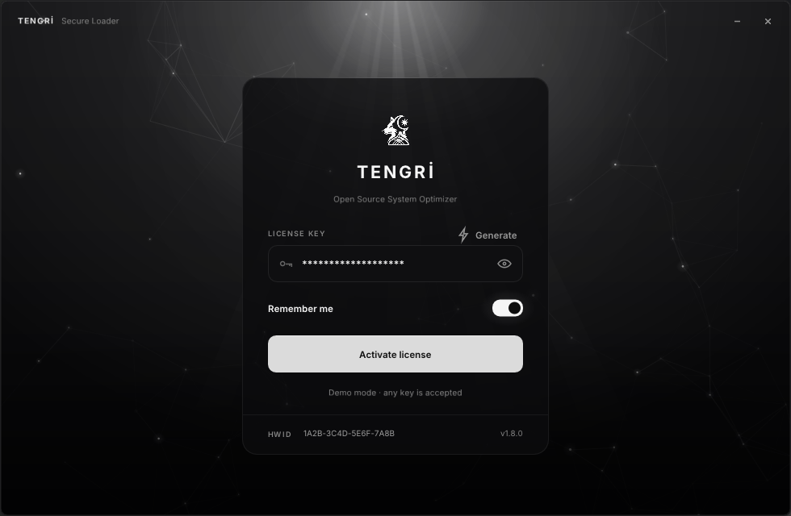

Gösterge paneli — canlı CPU / RAM / disk kullanımı, 30 saniyelik gerçek CPU yükü grafiği
ve canlı durumdan hesaplanan sağlık puanı:


Temizleyici:

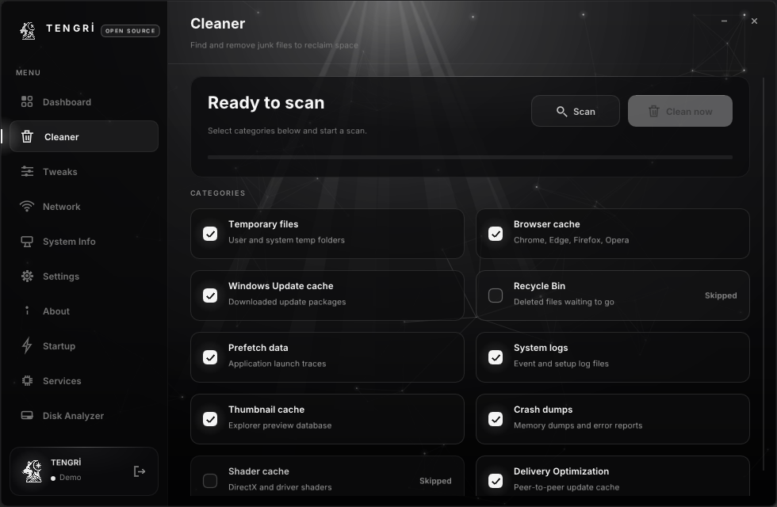

İnce ayarlar:

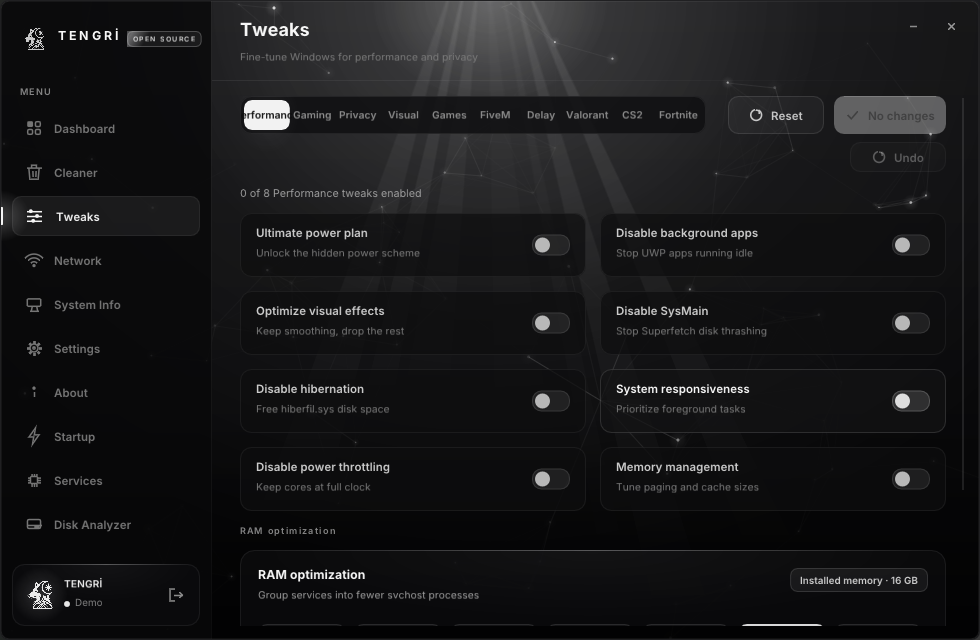

Ağ:

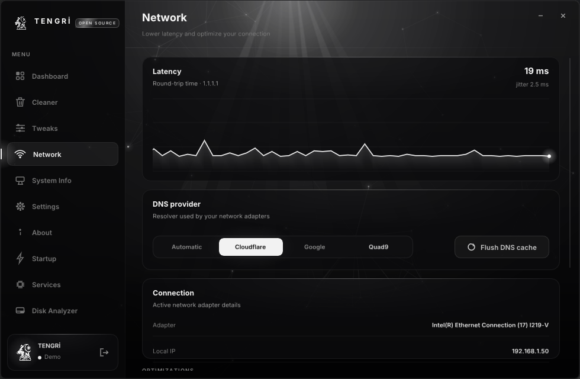

Sistem bilgisi:

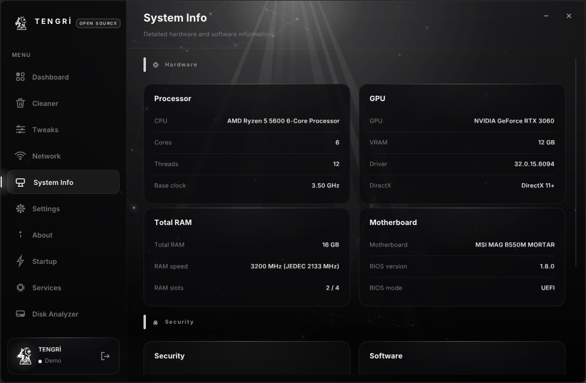

Ayarlar:

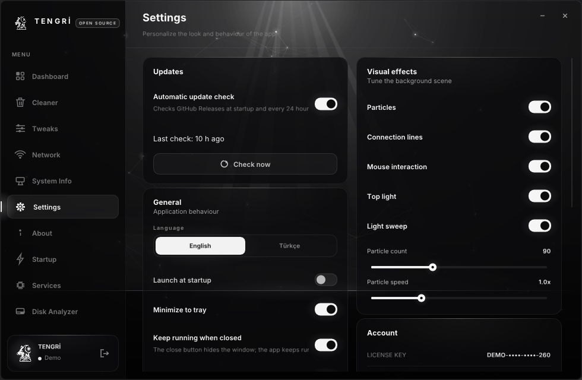

Hakkında:

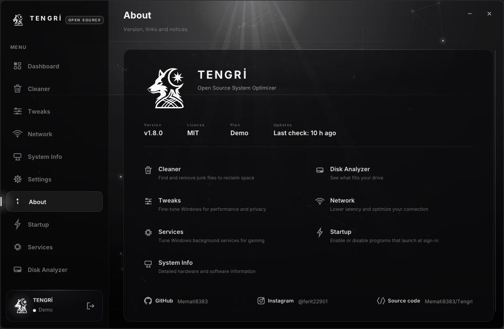

Başlatma:

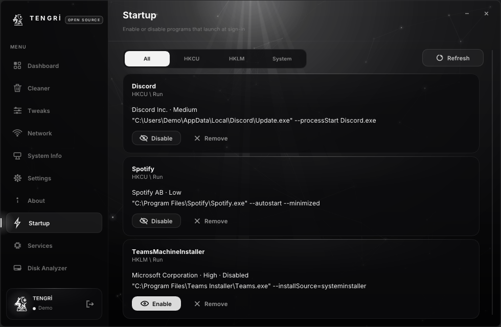

Hizmetler:

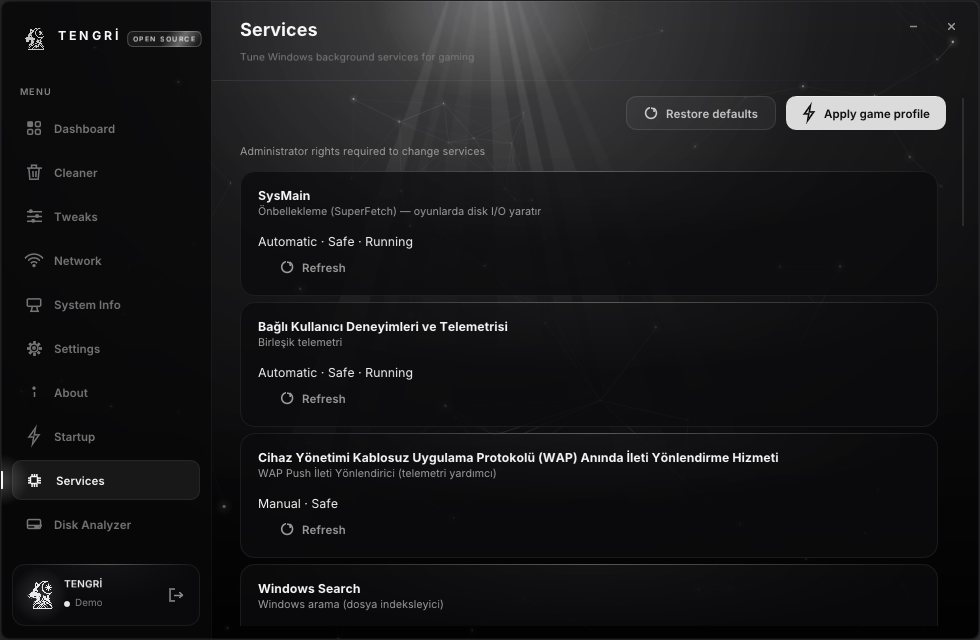

> **Disk Analizörü'nün görseli yok**, ve bu bir eksiklik değil tercih: ekran makineye
> özgü klasör adlarını ve boyutlarını çiziyor, `TENGRI_SHOT` kipi ise yalnızca
> tanıtıcı alanları (HWID, ad, donanım, Başlatma listesi) maskeleme sözü veriyor —
> sürücünün ad alanını maskelemiyor. Bu yüzden onuncu sekmenin davranışı görselle
> değil, [Disk Analizörü](#disk-analizörü) bölümündeki tablolarla anlatılıyor.

Medya adası — masanın üstünde yüzen, çalmakta olan parçayı gösteren ayrı bir pencere.
Üzerine gelince genişler, tekerlekle ses ayarlar; `INSERT` ile gizlenip açılır:


> On bir görselin tamamı (giriş + dokuz ekran + medya adası) `tools\capture_all.ps1` ile **tek
> oturumda**, aynı tema ve aynı DPI ile üretildi. Betiği çalıştırırsan görseller bu dizine
> yeniden düşer. Görseller gerçek bir makinede alındı, ama **makineyi tanıtan alanlar uydurma**:
> betik `TENGRI_SHOT=1` ile açıldığı için HWID, bilgisayar/oturum adı, işlemci/ekran
> kartı/ana kart/BIOS, RAM hızı, ağ adaptörünün adı, yerel IP, Başlatma listesi ve
> lisans maskesi sabit örnek değerlerle çiziliyor. Canlı ölçüm kalan yerler — CPU
> yüzdesi, kullanılan bellek, boş disk, sağlık puanı, gecikme grafiği, hizmet durumları
> — yakalama anındaki gerçek değerler.
>
> Görseller 1.8.0 derlemesinden `TENGRI_SHOT=1` ile yeniden alındı. Kenar çubuğunda on
> sekme var (Disk Analizörü eklendi); Medya adası ayrı bir yüzey olduğu için kendi karesi
> ayrıca duruyor ve örnek veri kipinde sabit bir parçayla çizilir — gerçek medya oturumu
> okunmaz, lrclib.net'e istek gitmez.

---

## Çalıştırmadan önce

Antivirüsünüzün uyarı vermesi beklenir. TENGRİ `HKEY_LOCAL_MACHINE` altına **doğrudan**
yazıyor (`RegCreateKeyExW` + `RegSetValueExW`), hizmet başlangıç türünü değiştiriyor ve
`sc` / `powercfg` / `netsh` / `net` alt süreçlerini System32'den tam yolla çağırıyor.
Bu tam olarak bir "registry temizleyici" zararlı yazılım ailesinin davranış imzası,
bu yüzden sezgisel motorlar imzasız çalıştırılabilirleri işaretliyor. TENGRİ imzasız ve
tespitler bu yüzden beklenen bir sonuç. Ayrıntı:
[SECURITY.md](SECURITY.md) ve [Yükseltme](#yükseltme).

> **Geçmişte ne yapıyordu.** İlk sürümlerde değişecek değerler önce `%TEMP%`'e bir `.reg`
> dosyasına yazılıp `reg.exe import` ile içe aktarılıyordu. O yol kaldırıldı — dosya
> hiçbir zaman açılmıyor, yazma süreç içinde oluyor. Gerekçe:
> [Yazma kapıları](#yazma-kapıları).

Ayar uygularken yönetici yetkisi istenir, ancak uygulamayı açarken ve sistem bilgisi
okurken **hiç sorulmaz**. Ayrıntı: [Yükseltme](#yükseltme).

---

## Özellikler

### Ekranlar

| Ekran | Ne yapar |
|---|---|
| **Gösterge Paneli** | Canlı sistem metrikleri, CPU geçmişi grafiği, sağlık puanı, tek tıkla optimizasyon, sistem ve abonelik özeti |
| **Temizleyici** | 10 kategoride asenkron tarama ve silme, kategori seçimi, tarama/temizleme durumu |
| **İnce Ayarlar** | 10 kategori, 80 ayar; her ayar başlangıçta registry'den okunur |
| **Ağ** | Gerçek ICMP gecikme ölçümü, DNS geçişi, bağlantı ayrıntıları, 6 ağ anahtarı |
| **Sistem Bilgisi** | Donanım, yazılım ve güvenlik ayrıntıları |
| **Ayarlar** | Görsel efektler, davranış, dil, hesap, bildirimler |
| **Hakkında** | Marka bloğu, sürüm/lisans/plan/güncelleme şeridi, yedi ekrana sıçrayan yetenek listesi, sosyal ve kaynak kod bağlantıları |
| **Başlatma** | Otomatik başlayan programlar; değeri silmeden devre dışı bırakma |
| **Hizmetler** | Beyaz listedeki Windows arka plan hizmetleri için başlangıç türü ve oyun profili |
| **Disk Analizörü** | Sürücünün `$MFT` kayıtlarından yerleşim ağacını okur; harita/liste/tür/yinelenen görünümleri, çöp kutusuna silme, önbellek |

---

### Gösterge Paneli

| Özellik | Ayrıntı |
|---|---|
| İşlemci yükü | Win32 `GetSystemTimes` üzerinden canlı, çekirdek süresinden boşta süre ayrı tutularak hesaplanır |
| Bellek | `GlobalMemoryStatusEx` ile kullanılan / toplam GB |
| Depolama | Toplam ve boş alan; sağlık puanına girer |
| Sağlık puanı | 0-100; CPU yükü, RAM baskısı ve boş diskten canlı anlık görüntüyle hesaplanır |
| CPU geçmişi | Kayan 30 saniyelik gerçek yük grafiği (rastgele yürüyüş değil) |
| Hızlı optimize et | Çalışma kümesini kırpma + DNS önbelleğini boşaltma |
| Sistem özeti | İşletim sistemi, işlemci, ekran kartı, bilgisayar, kullanıcı, çalışma süresi |
| Abonelik | Plan, durum, bitiş, HWID |

---

### Temizleyici — 10 kategori

| Kategori | Ne siler | Özel davranış |
|---|---|---|
| Geçici dosyalar | Kullanıcı ve sistem geçici klasörleri | — |
| Tarayıcı önbelleği | Chrome, Edge, Firefox, Opera, Brave | **Firefox** profil başına, yalnızca `cache2`; profil kökü (oturumlar, yer imleri, eklentiler) asla silinmez |
| Windows Update önbelleği | İndirilmiş güncelleme paketleri | `wuauserv` ve `BITS` durdurulur, yalnızca biz durdurduysak geri başlatılır |
| Geri Dönüşüm Kutusu | Silinen dosyalar | — |
| Önyükleme verileri | Prefetch | — |
| Sistem günlükleri | Olay günlükleri | — |
| Küçük resim önbelleği | Küçük resim veritabanı | — |
| Çökme dökümleri | Bellek dökümleri ve hata raporları | — |
| Gölgelendirici önbelleği | `%LOCALAPPDATA%\D3DSCache`, `NVIDIA\DXCache·GLCache·NV_Cache`, `AMD\DxCache·GLCache·VkCache`, `Intel\ShaderCache` | Varsayılan tarama sürücü klasörleriyle sınırlı; **Steam** shader önbelleği aynı listede durur ama varsayılan kombinasyona dahil değildir — açık onay olmadan sayılmaz ve silinmez |
| Teslim Optimizasyonu | İndirme dağıtım önbelleği | — |

| Davranış | Ayrıntı |
|---|---|
| Bağlantı güvenliği | Junction ve sembolik bağlantılar (`FILE_ATTRIBUTE_REPARSE_POINT`) yaprak sayılır, içine girilmez; bağlantı döngüsü taramayı sınırsızlaştıramaz |
| İş parçacığı | Tarama ve silme arka plan iş parçacığında, arayüzü bloklamaz |
| Kategori seçimi | Her kategori ayrı onay kutusu; yalnızca işaretlenenler taranır |
| Tutarlılık | Günlük silme seçeneği kapatıldığında tarama da aynı şekilde uygulanır |

---

### İnce Ayarlar — 10 kategori, 80 ayar

Her ayar başlangıçta registry'den **gerçek** durumunu okur, böylece arayüz kaydedilmiş
bir ayar dosyası değil, gerçekte uygulanan şeyi gösterir.

**Uygula** yalnızca seçili kategoriye ve yalnızca gerçekten dokunduğun ayarlara yazar.
Dokunulmamış bir kayıt, başka bir aracın sahip olduğu bir değerin üstüne asla geri
alınmaz. İki anahtarın ortak sahiplendiği değerler etkin olan anahtardan yeniden
dayatılır.

**Yazmadan önce yedek alınır.** Düğmeye bastığında **yalnızca dokunulacak değerler**
okunur ve `%LOCALAPPDATA%\TENGRI\backups` altına kendi dışa aktarım üreticimizle
(`.reg` metni, `CREATE_NEW`) yazılır; sayfadaki **Geri al** düğmesi aynı okuyucuyla
bunu geri yazar. Ayrıntı için [Geri alma](#geri-alma).

#### Performans

| Anahtar | Ne yapar |
|---|---|
| Maksimum güç performans planı | Gizli güç performans planını açar |
| Arka plan uygulamalarını kapat | Boşta çalışan UWP uygulamalarını durdurur |
| Görsel efektleri optimize et | Yumuşatma korunur, geri kalanı kaldırılır |
| SysMain'i kapat | Superfetch'in disk tıkamalarını durdurur |
| Hibernation'ı kapat | `hiberfil.sys` disk alanını boşaltır |
| Sistem duyarlılığı | Ön plan işlerine öncelik verir |
| Güç kısıtlaması kapat | Çekirdekleri tam saat hızında tutar |
| Bellek yönetimi | Sayfalama ve önbellek boyutlarını ayarlar |

#### Oyun

| Anahtar | Ne yapar |
|---|---|
| Oyun modu | Oyunları kaynaklarda önceliklendirir |
| Tam ekran optimizasyonları | Tam ekran dışı modu için devre dışı bırakır |
| Donanım GPU zamanlaması | Kare zamanlaması gecikmesini düşürür |
| Game Bar'ı kapat | Katman ve DVR yakalamasını kaldırır |
| Ham fare girdisi | İşaretçi hızlandırmasını kapatır |
| Zamanlayıcı çözünürlüğü | Daha sıkı kare zamanlaması sağlar |
| CPU önceliği yükselt | Etkin oyun sürecini güçlendirir |
| Oyun modu (eski başlıklar) | Oyun modunu eski çalıştırılabilirlere uygular |

#### Gizlilik

| Anahtar | Ne yapar |
|---|---|
| Telemetriyi kapat | Tanılama verisi yüklemelerini durdurur |
| Etkinlik geçmişini kapat | Zaman çizelgesinin kaydedilmesini engeller |
| Reklam kimliğini kapat | Kişiselleştirilmiş reklam izlemeyi kaldırır |
| Konum izlemeyi kapat | Sistem genelinde konumu engeller |
| Cortana'yı kapat | Sesli asistanı kapatır |
| Geri bildirim isteklerini engelle | Asla geri bildirim istemez |
| Kişiselleştirilmiş deneyimler | Kullanım tabanlı ipuçlarını devre dışı bırakır |
| Hata raporlamayı kapat | Çökme raporlarının gönderilmesini engeller |

#### Görsel

| Anahtar | Ne yapar |
|---|---|
| Animasyonları kapat | Anında pencere geçişleri sağlar |
| Saydamlığı kapat | Düz görev çubuğu ve menüler verir |
| Klasik sağ tık menüsü | Tam sağ tık menüsünü geri getirir |
| Dosya uzantılarını göster | `.exe`, `.txt` vb. dosyaları daima gösterir |
| Gizli dosyaları göster | Gizli klasörleri ortaya çıkarır |
| Görev çubuğu aramasını gizle | Görev çubuğu alanını geri kazanır |
| Kilit ekranı ipuçlarını kapat | Kilit ekranını temizler |
| Başlangıç gecikmesini kapat | Başlangıç uygulamalarını anında başlatır |

#### Oyunlar

| Anahtar | Ne yapar |
|---|---|
| Oyun görev önceliği | GPU 8 / CPU 6 / yüksek zamanlama |
| Game DVR'ı kapat | Kayıt ve FSE kipini kapatır |
| Saat hızı | 10000 tik, arka plan sınırı yok |
| Çekirdek başına GPU DPC | Sürücü DPC'lerini çekirdeklere dağıtır |
| NVIDIA iş parçacığı önceliği | `nvlddmkm`'yi öncelik 31'e çıkarır |
| Sayfalama yürütmesini kapat | Çekirdek kodunu fiziksel bellekte tutar |
| Büyük sistem önbelleği | Dosya önbelleğini çalışma kümesine tercih eder |
| IO sayfa kilit sınırı | 1 MB kilit sınırı, daha büyük L2 ipucu |

#### FiveM

| Anahtar | Ne yapar |
|---|---|
| FiveM görev boost | FiveM için tam oyun görev profili |
| SistemResponsiveness 0 | CPU'nun %100'ünü ön plan işlerine verir |
| Ağ kısıtlamasını kapat | Paket/ms başına 10 paketlik sınırı kaldırır |
| Anlık menüler | Menüler, açılış beklemeye gerek olmadan |
| Hızlı uygulama sonlandırma | Takılan uygulama zaman aşımlarını kısaltır |
| Düşük seviye kanca zaman aşımı | 5000 ms yerine 1000 ms |
| Servis sonlandırma zaman aşımı | Servisleri daha hızlı kapatır |
| Pencere sürüklemesini kapat | Daha hafif pencere hareketi |

#### Valorant

| Anahtar | Ne yapar |
|---|---|
| Valorant süreç önceliği | Oyun sürecine CPU/IO/sayfa önceliği verir |
| Riot istemcisini arka plana | Lobi ve istemci süreçleri oyunu bekler |
| Vanguard'ı arka plana | `vgc`/`vgtray` kritik yoldan çıkar |
| Tam ekran optimizasyonu kapalı | Kenarlıklı pencerede DWM geçişini kaldırır |
| Oyun görevi zamanlaması | GPU 8 / CPU 6 / yüksek zamanlama |
| Düşük seviye kanca zaman aşımı | 5000 ms yerine 1000 ms |
| Ağ kısıtlamasını kapat | Paket/ms başına 10 paketlik sınırı kaldırır |
| SistemResponsiveness 0 | CPU'nun %100'ünü ön plan işlerine verir |

#### CS2

| Anahtar | Ne yapar |
|---|---|
| CS2 süreç önceliği | `cs2.exe`'yi zamanlayıcının üstüne çıkarır |
| Steam'ı arka plana | Steam menüleri CPU için yarışmaz |
| Steam web yardımcısını arka plana | İçerik sayfaları G/Ç için yarışmaz |
| Steam geç yüklemeyi kapat | Kütüphaneyi başlangıçta tam yükler |
| Oyun görevi zamanlaması | GPU 8 / CPU 6 / yüksek zamanlama |
| Oyun Modu | Windows oyunu senin yerine zamanlar |
| Game DVR'ı kapat | Kaplama ve DVR kaydını kaldırır |
| Ham fare | İşaretçi hızlandırması kapalı |

> Source 2 kendi iş parçacıklarını yönetir; eski CS:GO başlatma seçenekleri artık
> işe yaramıyor. Profil yalnızca Windows tarafını değiştirir.

#### Fortnite

| Anahtar | Ne yapar |
|---|---|
| Fortnite süreç önceliği | Oyun sürecine CPU/IO/sayfa önceliği verir |
| Epic launcher'ı arka plana | İndirmeler oyuna yünsün |
| Epic servislerini arka plana | EOS ve web yardımcısı oyuna yünsün |
| Tam ekran optimizasyonu kapalı | Kenarlıklı pencerede DWM geçişini kaldırır |
| Oyun görevi zamanlaması | GPU 8 / CPU 6 / yüksek zamanlama |
| Oyun Modu | Windows oyunu senin yerine zamanlar |
| Ham fare | İşaretçi hızlandırması kapalı |
| SistemResponsiveness 0 | CPU'nun %100'ünü ön plan işlerine verir |

#### Gecikme

| Anahtar | Ne yapar |
|---|---|
| Global zamanlayıcı çözünürlüğü | 0.5 ms zamanlayıcı isteklerini kabul eder |
| DPC watchdog profili | DPC gözlet profilini gevşetir |
| İstisna zinciri doğrulaması | SEHOP zincir kontrollerini atlar |
| Kesme yönlendirme | Kesmeleri kendi çekirdeğinde tutar |
| Win32 öncelik ayrımı | 0x28 - kısa, sabit kuantumlar |
| Güvenilirlik zaman damgası | Güvenilirlik örnekleme yazılarını durdurur |
| Paylaşım ihlali beklemesi yok | Paylaşım ihlali beklemesini kaldırır |
| Fare girdi gecikmesi düzeltmesi | AAP eşiği ve özellik ayarları |

---

### Ağ

| Özellik | Ayrıntı |
|---|---|
| Gecikme ölçümü | 1.1.1.1'e gerçek ICMP tur-çevrimi, arka plan iş parçacığında; ilk örnek düşene kadar grafik "bekliyor" der |
| Jitter | Ardışık ölçümler arası değişim |
| DNS sağlayıcısı | Otomatik / Cloudflare / Google / Quad9, `netsh` üzerinden; seçimden sonra çözümleyici boşaltılır |
| DNS önbelleğini temizle | Çözümleyici önbelleğini boşaltır |
| Bağlantı ayrıntıları | Aktif adaptörün adı, yerel IP, ağ geçidi |

**Ağ anahtarları**

| Anahtar | Ne yapar | Durum |
|---|---|---|
| TCP otomatik ayarlama | En iyi alma penceresi ölçeklendirmesi | Etkin |
| Nagle algoritmasını kapat | Küçük paketler için daha düşük gecikme | Etkin |
| Ağ kısıtlama indeksi | QoS paket zamanlayıcısı | Etkin |
| QoS paket zamanlayıcı | QoS için bant genişliği çift yönlü ayarlama | Etkin |
| Büyük gönderme kapatma | Adaptörlerde LSO'yu kapatır (v4 ve v6) | Etkin |
| Kesme moderasyonu | Adaptör sürücüsüne özel, genel karşılığı yok | **Gri** — sessizce işe yaramak yerine devre dışı gösterilir |

Adaptör seçimi döngü, tünel ve sanal NIC'leri yok sayar; bağlantı adları `netsh`'e
ulaşmadan önce temizlenir.

---

### Başlatma

Windows'un otomatik başlatma mekanizmaları çok sayıdadır (zamanlanmış görevler,
hizmetler, WMI tetikleyicileri, kabuk klasörleri). Bu ekran yalnızca **oturum
açıldığında doğrudan çalışan kodu** listeleyebilen yolları yönetir; dolaylı yollar
(GPO betiği, hizmet tetikleyicisi, WMI aboneliği) kapsam dışıdır.

**Devre dışı bırakılabilen kapsamlar**

| Kapsam | Anahtar / yol | Yazma yetkisi |
|---|---|---|
| HKCU · Run | `Software\Microsoft\Windows\CurrentVersion\Run` | **istemez** |
| HKCU · RunOnce | `Software\Microsoft\Windows\CurrentVersion\RunOnce` | **istemez** |
| HKLM · Run | `Software\Microsoft\Windows\CurrentVersion\Run` | ister |
| HKLM · RunOnce | `Software\Microsoft\Windows\CurrentVersion\RunOnce` | ister |
| HKCU · Policy · Explorer · Run | `...\CurrentVersion\Policies\Explorer\Run` | **istemez** |
| HKLM · Policy · Explorer · Run | `...\CurrentVersion\Policies\Explorer\Run` | ister |
| Başlangıç klasörü (kullanıcı) | `%APPDATA%\Microsoft\Windows\Start Menu\Programs\Startup` | **istemez** |
| Başlangıç klasörü (tüm kullanıcılar) | `%PROGRAMDATA%\Microsoft\Windows\Start Menu\Programs\Startup` | ister |

**Yalnızca gösterilen kapsam**

| Kapsam | Anahtar |
|---|---|
| HKCU · Winlogon | `Software\Microsoft\Windows NT\CurrentVersion\Winlogon` |
| HKLM · Winlogon | `SOFTWARE\Microsoft\Windows NT\CurrentVersion\Winlogon` |

> **Neden Winlogon yönetilmiyor.** `Shell` ve `Userinit` oturum açmanın kendisidir.
> `Userinit` kapatıldığında Windows bu değeri kullanıcı oturumunda yeniden yazar
> (yani zararsız görünür); ama `Shell` boşalırsa **oturum açılmaz** ve düzeltmek
> başka bir oturum açmayı gerektirir. Bu yüzden bu iki kapsam listelenir,
> standart değerden saptıklarında **işaretlenir**, düğmeleri kapalı gelir.
> Bir yarım kalmış temizlikten iyidir.
>
> Yalnızca `Shell` ve `Userinit` listelenir: Winlogon anahtarında `Taskman`,
> `GINA`, `ReportFault` gibi kırk değer daha vardır ve hiçbiri başlangıç öğesi
> değildir. `Userinit` için varsayılan `userinit.exe,` (kendisi virgülle biten)
> **sapan sayılmaz**; sapan olan, sonuna eklenen ikinci yoldur.

| Davranış | Ayrıntı |
|---|---|
| Devre dışı bırakma | Değer **silinmez**, `Software\TENGRI\StartupDisabled\<kapsam>` anahtarına **taşınır**: HKLM kapsamları HKLM'e, HKCU kapsamları HKCU'ya. Açıp kapamak gerçek bir ters işlemdir; kullanıcının kendi değeri kaybolmaz |
| Startup klasörü | Dosya **taşınır**: `%APPDATA%\TENGRI\startup-disabled\`. Aynı adda bir dosya zaten oradaysa işlem reddedilir — üstüne yazmak geri almanın yanlış dosyayı döndürmesine yol açardı |
| Neden `StartupApproved` değil | Windows'un kendi devre dışı bırakma anahtarı sürümden sürüme anlambilim değiştiriyor ve üçüncü parti araçlarla çarpışma riski taşıyor. Kendi anahtarımız bu riski hiç taşımaz |
| Silme | Ayrı bir düğme, gerçek `RegDeleteValue`. Taşımaktan farklı bir eylem olduğu için arayüzde de ayrı durur |
| Yedeklerin yeri | Yedeğin hive'ı girdinin hive'ıyla aynı: makine kapsamlı bir komut HKCU'dan okunup HKLM\Run'a **yazılmaz** (aynı kullanıcıda koşan bir program HKCU'yu yazabilir; yükseltilmiş süreç üzerinden HKLM\Run'a taşımak yönetici yetkisiyle kalıcılık olurdu). Makine girdisini kapatmak zaten HKLM yazdığı için ek UAC istemez |
| Kendi kaydı | Uygulamanın `Run` girdisi listede **"TENGRİ otobaşlatma"** olarak görünür ama **silme düğmesi kilitlidir** — kendi kendini kaldıramaz. Açıp kapatmak Ayarlar ekranından yapılır, iki yerin ayrışmaması için |
| Satır içeriği | Ad + kapsam, altında yayıncı (`VERSIONINFO` şirket adı; yoksa çözülen yol), etki ve komut satırı |
| Etki tahmini | Hedef dosyanın disk boyutundan sezgisel (Düşük <2 MB, Orta <20 MB, Yüksek ≥20 MB, okunamazsa Bilinmiyor). Kesin bir ölçüm değil, bir sıralama ipucu |
| Filtre | Tümü / HKCU / HKLM / Sistem. **Sistem** kapsamı registry'de olmayan veya oturumun parçası olan yolları toplar: iki Startup klasörü ve iki Winlogon anahtarı. Her işlemden sonra liste baştan taranır, kayan index üzerinden yanlış satıra dokunulmaz |
| Kapatılamayan girdi | Düğmeler yerine nedeni yazılır. Boş bir düğmeden çok nedeni bilmek işe yarar |
| Yetki yoksa | HKLM ve ortak Startup klasörü yazması sessizce başarısız olmaz — uyarı bildirimi gösterilir, arayüzü değişmiş gibi yapmaz. Kapsamın yetki isteyip istemediği `startup::NeedsElevation()` ile **işlemden önce** sorulur; deneme-yanılma yolu yoktur |

---

### Hizmetler

Oturumda disk I/O, bellek ve CPU çalan arka plan hizmetleri için **başlangıç türü**
yönetimi. Hizmetler **durdurulmaz** — durdurma anlıktır ve bir sonraki oturumda
unutulur; başlangıç türü değişikliği kalıcıdır ve "oyun profili" ile "varsayılan
profil" arasında tekrarlanabilir geçişe izin verir.

| | |
|---|---|
| Kapsam | Kodda sabit **16 hizmetlik beyaz liste** |
| Liste dışı ad | Arayüzde serbest hizmet adı girilemez; `SetStartType` liste dışını reddeder |
| Kritik hizmetler | `RpcSs`, `Dhcp`, `LanmanServer`, `Winlogon` vb. **kasıtlı olarak yoktur** ve çalışma zamanında ada eşleştirilemez |
| Uyarı seviyesi | Her satırda **Güvenli** / **Dikkat** / **Riskli** etiketi çizilir (ör. `SysMain` Güvenli, `WSearch` Dikkat — arama kaybı, `PrintNotify` Riskli) |
| Oyun profili hedefi | Telemetri ve benzeri `Devre dışı`; ilk ihtiyaçta kendiliğinden başlatılabilenler **Elle** (`Disabled` yerine `Manual` tercih edilir, böylece özellik tamamen ölmez) |
| Profil öncesi yedeği | Mevcut başlangıç türü + `DelayedAutostart` bayrağı `HKLM\SOFTWARE\TENGRI\ServicesBackup\<hizmet>` altına yazılır; yalnızca **gerçekten değişecekse** yedeklenir |
| Profil düğmeleri | **Oyun profilini uygula** ve **Varsayılanlara dön**; değişen hizmet sayısı bildirimde söylenir. **Varsayılanlara dön** yedekten geri okur; hedef zaten istenen türdeyse hizmete hiç dokunulmaz |
| Yetki | Okuma (durum + tür) yükseltmeden çalışır; yazma yükseltilmiş süreç ister (`SC_MANAGER_CONNECT` + `SERVICE_CHANGE_CONFIG`). Yetki yoksa liste yine çizilir ve sayfa üstte gerekçesini söyler |

Liste: `SysMain`, `DiagTrack`, `dmwappushservice`, `WSearch`, `XblGameSave`,
`XblAuthManager`, `XboxGipSvc`, `XboxNetApiSvc`, `WbioSrvc`, `MapsBroker`,
`RetailDemo`, `RemoteRegistry`, `Fax`, `PrintNotify`, `WerSvc`, `DoSvc`.

---

### Disk Analizörü

Onuncu ekran: **diskini neyin doldurduğunu** gösterir. Klasör boyutlarını alt alta
toplamak yerine NTFS'in kendi defterini okur — `$MFT` kayıtları yol, boyut, tahsis,
tarih ve sahip bilgisini dosyaların kendisine inmeden verir. `$MFT`'e erişilemeyen
her durumda (NTFS olmayan hedef, tek bir klasörün seçilmesi, ham sürücü erişiminin
reddi) aynı arayüz sıradan özyinelemeli yürüyüşe düşer; tarama yarım kalmaz, yolu
değişir ve bunu ekranda da söyler.

| Konu | Ayrıntı |
|---|---|
| Hedef | **SÜRÜCÜLER** şeritindeki düğmeler (liste 20 saniyede bir tazelenir) veya **Klasör seç...** ile herhangi bir klasör. Sürücü kökünde MFT motoru denenir |
| Motor etiketi | Tarama düğmesinin yanında **MFT hızlı tarama** / **Paralel gezi** yazar — hangi yoldan geldiğini tahmin etmene gerek kalmaz |
| Yetki | Ekran **UAC istemez**. `\\.\C:` açılabiliyorsa `$MFT` okunur; açılamıyorsa yürüyüşe düşer ve altta "Anında MFT taraması için yönetici olarak çalıştır" satırı çıkar |
| Boyut | Çizilen değer **diskte kapladığı yer**dir: kümeye yuvarlanmış tahsis. 4 KB'lık kümede 1 KB'lık dosya 4 KB görünür. Nominal boyut ile fark budur |
| Boyutu okunamayan | `$MFT` kaydında boyut taşımayan dosyalar ağaçta 0 görünür; tarama satırı "%u dosyanın boyutu okunamadı" diye kaç tane olduğunu söyler — 0 gerçek sanılmasın |
| İş parçacığı | **MFT okuma iş parçacığı** kaydırıcısı 1–8; varsayılan mantıksal çekirdek sayısı (1–8'e kırpılır). Değer **tarama başladığında** motora yazılır, çalışan taramanın iş parçacıkları yolda değiştirilmez — bu yüzden kaydırıcı yalnızca boşta görünür |

**Ölçülen.** C: sürücüsü, `$MFT` 1.270.087.680 bayt, ~720.000 düğüm, her satır iki ayrı
koşu; rakamlar `tools\verify_checkpoint1.ps1` raporundan:

| İş parçacığı | Tarama süresi |
|---|---|
| 1 | 80,1 – 81,9 s |
| 2 | 22,1 – 23,6 s |
| 4 | 10,6 – 10,8 s |
| 8 | **1,50 – 1,55 s** |

Sıra kontrolü yapıldı: aynı matris tersinden koşuldu ve tek iş parçacığı 106,4 s'ye
çıktı — yani kazanç koşu sırasından değil, dilim sayısından geliyor. Alternatif şema
(tek iş parçacıklı overlapped prefetch) aynı diskte 85,5 – 93,9 s'de kaldığı için
**yoldan silindi**; kalan şema `$MFT`'yi dilimlere bölen çok iş parçacıklı okuma.

| Görünüm | Ne çizer |
|---|---|
| **Harita** | İç içe treemap; düğüm başına en büyük 1500 çocuk, kalanı tek **Diğer** kutusunda. Çift tık klasöre girer, tek tık seçer, sağ tık menü açar. Yeterince büyük kutuda ad + boyut yazılır |
| **Liste** | 4000 satır + **Diğer** satırı; tıkla-seç çoklu seçim, klasörler ▫ işaretiyle, korumalar soluk renkle |
| **Türler** | Uzantı başına tahsis ve dosya sayısı; en büyük 24 satır + **Diğer**, her satır sürücü köküne oranlı çubukla |
| **Yinelenenler** | Aşağıdaki alt bölüm |

Klasörler tek tondur, dosyalar uzantılarından renk alır — haritada "kabın kendisi" ile
"içindeki dosya" gözle ayrışır. İçe içe geçme yolu Harita ve Liste arasında ortaktır:
üstte **Geri** düğmesi ve `C:\... > klasör > klasör` izi çizilir.

| İmleç kutusu | Kaynak |
|---|---|
| Ad + diskte kapladığı yer | ağaç düğümü |
| Sahip | `$SDS` güvenlik akışından çözülen SID → `LookupAccountSidA`. Görülen her sahip arka plan kuyruğuna atılır; kutu API cevabını beklemez |
| Değiştirme tarihi | `$STANDARD_INFORMATION` zaman damgası |
| Bayrak notu | sıkıştırılmış / seyrek / şifreli / bağ / çevrimdışı / +veri akışı / sert bağlantı / boyutu bilinmiyor |
| Sistem klasörü | korumalı köklerde satırın sonunda "Sistem klasörü" yazılır ve silme hiç teklif edilmez |

> **Sahip satırı uydurulmaz.** Dört hâl vardır ve dördü de farklı yazılır: ad çözülmüşse
> `MAKINE\Kullanıcı`, hâlâ sıradasa ham SID, çözümleme başarısızsa SID + "ad çözülemedi",
> düğümün sahip kaydı yoksa `-`. Ad geldiğinde kutu kendini tazeler.

| Silme | Ayrıntı |
|---|---|
| Yollar | Seçim çubuğu ve sağ tık menüsü: **Çöpe at** ya da **Kalıcı sil** |
| Onay | İkisinde de "%d öğe silinsin mi?" modalı açılır; modanın dışına tıklamak işlem **yapmadan** kapatır |
| Mekanizma | `IFileOperation`, kendi STA iş parçacığında; bitince kaç öğe taşındığı/silindiği bildirime yazılır. Çöp kutusuna taşımada `FOFX_RECYCLEONDELETE` kullanılır, kalıcı silmede bayrağın kendisi eklenmez |
| Dokunulmayanlar | Sürücü kökündeki `Windows`, `$Recycle.Bin`, `System Volume Information` ve `Recovery` **koruma işaretlidir**: düğmeleri çıkmaz, seçimde "Sistem klasörü" notu görünür. Taramanın kendi kökü de hiçbir zaman silinmez |
| Neden kabuk API'si | Silme Windows'un kendi yolundan geçtiği için çöp kutusu, geri alma ve kota davranışı standart kalır. Kullanıcı dosyaları için kod tabanında kendine ait bir `DeleteFileW` silme zinciri yok |

| Yinelenen dosyalar | Ayrıntı |
|---|---|
| Ne zaman | Tarama bittikten sonra **Yinelenenleri bul** düğmesiyle; arka plan iş parçacığında, **Durdur** ile iptal edilebilir |
| Faz 1 — boyut | Aynı boyutu paylaşan dosyalar aday olur. 4 KB'ın (bir küme) altındaki dosyalar ve korumalı klasörler adaya girmez |
| Faz 2 — örnek | Dosyanın ilk 4 KB'ı hash edilir. Boyut çakışması tek başına çok zayıf bir eliydi: sürücüde yüz binlerce dosya aynı boyutu paylaşır ve hepsini baştan okumak işlemi bitirilemez kılardı |
| Faz 3 — tam | Yalnızca örnekçe hâlâ çakışanlar diskin tamamını okur |
| Sonuç | Grup başına `boyut × (n − 1)` **boşa giden** olarak yazılır, azalan sırayla çizilir (en fazla 300 grup). Her satır **Birini tut, gerisini çöpe at** düğmesi taşır; düğme onay modalından geçer ve çöp kutusuna taşır, kalıcı silmez |

| Önbellek | Ayrıntı |
|---|---|
| Dosya | `%LOCALAPPDATA%\TENGRI\diskscan.tgds` — başlıkta `TGDS` imzası ve sürüm 3 |
| Otomatik | Tarama bittiğinde kendini yazar; uygulama açılırken son taramayı geri okur ve durum satırına **"önbellekten yüklendi"** yazar. Elle de **Taramayı kaydet** / **Son taramayı yükle** düğmeleri var |
| Okuma kapısı | Başlık, düğüm/sahip/uzantı sayıları, isim havuzu sınırları ve her düğümün indeksleri tek tek denetlenir; sınırdışına taşan tek bir indeks bütün dosyayı reddettirir. 800 MB üstü dosya hiç okunmaz, 20.000.000 düğüm üstü reddedilir |
| Eski sürüm | Oturumda bir kez: `TGDS` imzalı ama sürümü güncel olmayan dosya **silinir**. v1 ne tarih ne sahip taşımıyordu, v2 sahibi ham güvenlik kimliği numarası olarak tutuyordu — yarım ağacı sessizce göstermek yerine yeniden tarama tercih edildi. Yabancı imzalı, bozuk ya da güncel v3 dosyaya dokunulmaz |
| Ne içerir | Okunan sürücünün ad alanı: yol, ad, boyut, tarih ve sahip SID'leri. Yerelde kalır, hiçbir ağ isteğine girmez; silmek için dosyayı silmen yeterli |

| Doğrulama | Ayrıntı |
|---|---|
| Birim testler | `tests/test_disk.cpp` — 258 denetim: MFT kayıt ayrıştırması ölçülen ofsetlerle, `$SDS` sahip sözlüğü, önbellek gidiş-dönüşü ve red yolları, canlı yürüyüşün **yalnızca `%TEMP%`'de kurulan izole ağaçta** koşması |
| Gerçek disk | `tools\verify_checkpoint1.ps1` altı test paketini koşturur, sonra probe ile gerçek `$MFT`'yi 1/2/4/8 dilimde tarar; okunan=tamam, kökten ulaşılabilir düğüm, SID birebirliği ve kazanç eşiklerini denetler. Rapor `C:\Users\Public\tgengine\checkpoint1.txt` |
| Bu bölümün sayıları | İş parçacığı tablosu ve kapsam rakamları bu raporlardan alınmadır; tahmin içermez |

---

### RAM optimizasyon profili

Windows'un servisleri her servis için ayrı `svchost.exe` başlatmak yerine daha az sürece
toplamasını sağlar. 14 hazır profil:

| Profil | | Profil | |
|---|---|---|---|
| Default | 0 GB | 32 GB | 32 |
| 4 GB | 4 | 64 GB | 64 |
| 6 GB | 6 | 96 GB | 96 |
| 8 GB | 8 | 128 GB | 128 |
| 12 GB | 12 | 192 GB | 192 |
| 16 GB | 16 | 256 GB | 256 |
| 24 GB | 24 | 512 GB | 512 |

| Özellik | Ayrıntı |
|---|---|
| Otomatik öneri | Kurulu RAM'e en yakın profil önerilen olarak işaretlenir |
| Varsayılana dönüş | `Default` seçilince sistemin kendi değeri geri yüklenir |
| Canlı okuma | O an yazılı olan profil registry'den okunur |

---

### Sistem Bilgisi

| Alan | Kaynak | Not |
|---|---|---|
| İşlemci | Registry / `__cpuid` | Ad, fiziksel çekirdek, mantıksal iş parçacığı, taban saat |
| Ekran kartı | DXGI + display class anahtarı | Ad, VRAM, **sürücü sürümü** (DirectX registry değerinden değil, display class anahtarından) |
| DirectX | `GetVersionEx` | Sürüm |
| Toplam RAM | `GlobalMemoryStatusEx` | — |
| RAM hızı | WMI `Win32_PhysicalMemory` | `6000 MHz (JEDEC 4800 MHz)` — çalışma hızı ile JEDEC eşleşmiyorsa ikisi de |
| RAM yuvaları | WMI `Win32_PhysicalMemory` | Dolu yuva sayısı, ör. `1 dolu` |
| Anakart | Registry | Model |
| BIOS | Registry | Sürüm, **mod (UEFI / Legacy)** |
| TPM | WMI `Win32_Tpm` | Yalnızca WMI gerçekten satır döndürürse çizilir (aşağıya bakın) |
| Güvenlik | — | **Secure Boot durumu**, **sanalleştirme durumu** (firmware / VBS / Hyper-V) |
| Diğer | Registry | Windows kurulum tarihi, ekran çözünürlüğü, sistem dili |

Sorgular arka iş parçacığında koşar; panel açılırken beklemez. Değer henüz
gelmemişse satır **hiç çizilmez** — `N/A` gösterilmez, çünkü henüz bilinmeyen
bir şey "yok" demek değildir.

**TPM satırı çoğu zaman yok.** `Win32_Tpm` yalnızca TPM'si WMI'ye tanıtılmış
makinelerde satır döndürür; BIOS'un TPM'yi açsa bile olmayabilir. Satır ancak
veri varsa çizildiği için bu, hatadan çok dürüst bir davranış.

**VRAM neden DXGI ile okunuyor.** WMI'nin `AdapterRAM` alanı 32 bit bir tam
sayı; 4 GB üstü kartlarda taşıyor ve 16 GB'lık bir kartı 4 GB gösteriyordu.


---

### Ayarlar

| Bölüm | Seçenek |
|---|---|
| Görsel efektler | Parçacıklar, bağlantı çizgileri, fare etkileşimi, üst ışık, ışık süpürmesi |
| Parçacık ayarları | Parçacık sayısı (kaydırıcı), parçacık hızı (çarpan) |
| Güncellemeler | Otomatik denetim anahtarı, son denetim durumu, **Şimdi denetle / İndir / Kur ve yeniden başlat / Vazgeç** — ayrıntı aşağıda |
| Genel | Lisansı hatırla, uygulama içi bildirimler, Windows bildirimleri, sadece hatalar, başlangıçta çalıştır, tepsi simgesine küçült, kapatınca arka planda çalışmaya devam et |
| Dil | Genel kartının en üstünde bir bölüm olarak, English / Türkçe — seçim kalıcı olarak saklanır |
| Hesap | Maskelenmiş lisans anahtarı, plan, bitiş, demo lisans bildirimi, çıkış yap |

| Davranış | Ayrıntı |
|---|---|
| Başlangıçta çalıştır | Gerçek bir `HKCU\...\Run` girdisi yazar ve geri okur, böylece anahtar kayamaz |
| Tepsi simgesine küçült | Gerçek kabuk ikonu; sol tık geri getirir, sağ tık menü açar (aşağıya bakın). Kabuk ikonu reddederse sıradan küçültmeye düşer. **İlk küçültmede bir kez balon** çıkar (aşağıya bakın) |
| Kapatınca arka planda çalışmaya devam et | **Kapat (X)** düğmesi uygulamanı sonlandırmaz, pencereyi gizler; süreç tepside çalışmayı sürdürür. Açılışta varsayılan olarak açık, kalıcı değil — her oturumda pencereyi kapatmanın ne yapacağına o oturumda karar verilir. Windows bildirimleri kapalıysa ya da kabuk ikonu alınamazsa düğme çalışmaya devam eder ve **gerçekten çıkar**; ikonu olmayan bir arka plan süreci sessizce yaşayan bir süreç olurdu |
| Tepsi sağ tık menüsü | Başlıkta ad + sürüm. **Pencereyi aç** (varsayılan/bold öğe), on ekranın tamamını listeleyen **Sayfaya git** alt menüsü, **Geri al** (yedek yoksa gri), **Windows bildirimleri / Sessiz mod / Başlangıçta çalıştır** üç işaretli anahtar, **Ayarlar** ve **Çık**. Menü hiçbir durumu kendi içinde tutmaz: işaretleri, erişilebilir sayfaları ve komutların ne yapacağını uygulamadan sorar, böylece tepsideki ile penceredeki anahtarlar ayrılamaz |
| Diller | İngilizce ve Türkçe; tüm metinler, tweak etiketleri ve sistem durumları çizim anında çözülür |
| DPI | Ölçekleme tüm boyutlarda uygulanır; monitör değişiminde yeniden ölçeklenir |

**Neden balon.** Windows 11 yeni tray ikonlarını çoğu zaman **gizli taşma alanına** atar.
İkon eklenir ve çalışır, ama görünür tepsi çubuğunda yoktur; yalnızca `^` okunun arkasındadır.
Kullanıcı küçültür, pencere kaybolur, tepsiye bakar ve ikonu bulamaz — o an "tepsiye küçültme
çalışmıyor" sanır. İlk küçültmede çıkan balon ikonun nereye gittiğini söyler. Bu ayrı bir
mekanizma değil, kabuğun kendi davranışı (`NIM_MODIFY` + `NIF_INFO`); yalnızca bir kez
gösterilir.

**İkonu kalıcı görünür yapmak.** Bunun API'si yok — kararı Windows veriyor. Elle yapılır:
`Ayarlar` → `Kişiselleştirme` → `Görev çubuğu` → **Diğer sistem tepsisi simgeleri** →
`TENGRİ` = Açık.

**Explorer yeniden başlarsa.** Kabuk ikonu Explorer'ın içinde yaşar; Explorer kapanıp
açıldığında (çökme, `explorer.exe` yeniden başlatma, bazı sürücü kurulumları) tüm tray
ikonları silinir. Uygulama kabuğun yayınladığı `TaskbarCreated` mesajını dinler ve ikon
bir tek o anda geri eklenir. Öncesinde bu eksikti: ikon bir kez kaybolduğunda bir daha
hiç geri gelmiyordu. Ayrıca `Tick()` bakım yolu, eklenememiş bir ikon için saniyede bir
`NIM_ADD` yeniden denemesi yapar.

---

### Windows bildirimleri

Uzun süren işler, yetki hataları ve ayar değişiklikleri Windows'un kendi bildirim
sistemiyle de haber verilir — uygulama kapalıyken de gelir, Eylem Merkezi'ne düşer.

Üç anahtar birbirinden bağımsızdır:

| Anahtar | Ne kapatır |
|---|---|
| Uygulama içi bildirimler | Pencerenin köşesindeki toaster'ları |
| Windows bildirimleri | Eylem Merkezi'ne düşen toast'ları |
| Sadece hatalar | İkisini birden — yalnızca hata ve uyarılar geçer |

Gönderilen olaylar: uzun süren işlerin sonucu (optimizasyon, tarama, temizlik, ayar
uygulama), yetki/hata uyarıları ve ayar değişiklikleri.

Toast'lar düğme taşır:

| Düğme | Davranış |
|---|---|
| Sonuçları gör | Uygulamayı açar ve **olayın kendi sayfasına** gider (Temizlik, Ağ, İnce Ayarlar…) |
| Geri al | **Önce onay ister.** Onaylanmadan registry'ye hiçbir şey yazılmaz |
| Tekrar dene | Yalnızca gerçekten saklanmış bir iş varsa görünür |
| Tamam | Sistem düğmesi; uygulamayı açmadan kapatır |

> **Geri al düğmesi:** bildirimden tek tıkla registry'ye dokunmak, o anda hangi
> pencereye baktığını bilmediğin bir durumda veri kaybı demektir. Bu yüzden düğme
> önce uygulamayı öne getirir ve onay penceresinde sorar.

**Kurulum.** Windows bildirimleri uygulamayı bir kısayol üzerinden tanır. İlk
çalıştırmada iki kayıt yazılır ve bir daha dokunulmaz:

```
HKCU\Software\Classes\AppUserModelId\TENGRI.SystemOptimizer
%APPDATA%\Microsoft\Windows\Start Menu\Programs\TENGRI.lnk
```

Kısayol elle silinirse yeniden kurulur. Ayarı kapatmak bu kayıtları silmez.

**Ayarı kapatmak** bildirimleri susturur, kayıtları silmez — bu yüzden tekrar açtığında
kurulumun baştan yapılması gerekmez.

> Rahatsız Etmeyin ve gece modu Windows'un kendi kararıdır; araç bu ayarların
> üzerine yazmaz. Sistem susturduğunda susturur, sadece Eylem Merkezi'ne kaydeder.

**Tek örnek.** Toast düğmeleri uygulamayı yeniden başlatarak tetikler (Windows'un
yapabildiği tek yol bu). Bunun iki pencere açmaması için uygulama tek örnek
kilitini tutar: ikinci açılış komutu ilk örneğe iletir ve kendini kapatır.

---

### Güncellemeler

Ayarlar'ın sağ sütunundaki ilk kart. Uygulama yeni sürümü GitHub Releases'tan öğrenir,
kurulumu ise **sana** sorar — kendiliğinden inen veya kendiliğinden kurulan bir şey yok.

| Öğe | Davranış |
|---|---|
| Otomatik güncelleme denetimi | Açıkken (varsayılan) açılışta bir, sonra pencere açık kaldığı sürece her 24 saatte bir denetlenir. Kapalıyken zamanlayıcı hiç çalışmaz; **Şimdi denetle** elle çalışmaya devam eder |
| Son denetim | "Az önce" / "N saat önce". Zaman damgası kalıcı: uygulama kapanıp açıldığında ilk denetim 24 saat bekler |
| Durum satırı | Denetleniyor / yeni sürüm mevcut / güncel / başarısız (ağ, HTTP, bulunamadı, bozuk bildirim, güvenilmeyen adres, dosya, sağlama uyuşmazlığı) |
| Rozet | Hakkında sayfasında "Güncelleme mevcut" / "Güncel" / "Denetleniyor" |
| Bildirim | Yeni sürüm bulunduğunda ve indirme doğrulandığında uygulama içi toast + Windows bildirimi. Bildirimin **İndir** düğmesi uygulamayı Ayarlar'da açar ve indirmeyi başlatır |

**Akış.** Denetim bir iş parçacığında yürür, arayüz beklemez.

1. `latest.json` indirilir: `version`, `url`, `sha256`, `size`
2. Sürüm üç parçalı sayısal olarak karşılaştırılır; seninki eşit veya daha yeni ise durum **Güncel**
3. **İndir** → dosya `%TEMP%\TENGRI\Update\` altına gider, kart yüzde olarak ilerler, **Vazgeç** yarım dosyayı siler
4. İki kapı: bildirilen bayt sayısı ve SHA-256. Uyuşmazsa indirilen parça **silinir** ve hata kartta görünür
5. Doğrulanınca kart **hazır** durumuna geçer; **Kur ve yeniden başlat** çalışan exe'yi kenara alır, yenisi yerine taşınır, eskisi **silinir**, `--tengri-relaunch` ile yeniden başlatılır
6. Exe klasörü yazılmıyorsa UAC **istenmez** — dosya `%TEMP%` içinde kalır ve kartta tam yolu gösterilir

> **Geri dönüş kopyası yok.** Takas sonrası eski exe silinir. Yanlış bir şey olursa
> kurtarma yolu Releases'tan aynı dosyayı elle indirip koymak. Bu bilinçli bir tercih;
> kart da "uygulama kapanır, yeni sürüm açılır" diye uyarıyor.

> **SHA-256 neyi yakalar, neyi yakalamaz.** Bozuk bir indirmeyi, yarıda kesilmiş bir
> aktarımı ve adresin başka bir dosyaya yönlendirilmesini yakalar — çünkü doğrulama
> değeri exe ile **ayrı** bir bildirim dosyasında geliyor. Yakalamadığı tek şey, deposu
> ele geçirilmiş bir yayındır: o durumda exe ile özeti aynı güven alanından çıkar.
> Gerçek kimlik zinciri (minisign ile imzalanmış bildirim) sonraki adımdır.

---

### Hakkında

| Öğe | İçerik |
|---|---|
| Marka bloğu | Logo, ürün adı ve tagline — tek sanat kaynağı `res/tengri-logo.png` |
| Meta şeridi | Sürüm (çalışan exe'nin sürüm kaynağından okunur), lisans, plan, güncelleme durumu |
| Güncelleme rozeti | "Güncelleme mevcut" / "Güncel" / "Denetleniyor" — bkz. [Güncellemeler](#güncellemeler) |
| Yetenek ızgarası | Yedi satır: Temizleyici, Disk Analizörü, İnce Ayarlar, Ağ, Hizmetler, Başlatma, Sistem Bilgisi — tıklayınca o ekrana geçer, sekme adları ve açıklamaları çeviriden gelir |
| Bağlantılar | Instagram, GitHub ve kaynak kod — GitHub silüeti gömülü AA maskesinden doku olarak çizilir, `ShellExecuteW` ile açılır |

---

### Medya Adası

Onuncu ekran bir pencere değil, **masaüstünün üstünde yüzen bir katmandır**: ana
pencere kapalı ya da tepsideyken bile durur. Windows'un sistem medya oturumunu (GSMTC)
dinler, yani Spotify gibi herhangi bir oynatıcının şu an çaldığı parçayı, kapağını ve
oynatma durumunu gösterir; kendi başına bir oynatıcı değildir.

| Konu | Ayrıntı |
|---|---|
| Ne gösterir | Şarkı adı, sanatçı, album, kapak resmi, ilerleme çubuğu, oynatma durumu; kapağın baskın rengiyle boyanır |
| Düğmeler | Oynat/duraklat, ileri, geri, karıştır, tekrarla, ses (tekerlek); komutlar gerçek oynatıcıya gider |
| Sözler | Senkronize sözler `lrclib.net`'ten alınır: önce tam eşleşme, olmazsa arama, olmazsa temizlenmiş başlıkla ikinci arama — üç deneme |
| Erişim | `INSERT` ile açılıp kapanır (hatırlanır), imleç üstüne gelince genişler, tekerlek sesi ayarlar |
| Ayarlar | Ada kartı: göster (varsayılan açık), tema (Black / Spotify / Aurora / Sunset / Ocean / Cover — altı, `src\core\island.cpp`), yalnızca masaüstünde (başka bir pencere öndeyken gizlenir), senkronize sözler (varsayılan açık) |
| Yetki | UAC istemez — medya oturumu okumak ve oynatıcıya komut göndermek yükseltme gerektirmez |
| Gizlilik | Okunan şarkı bilgisi yalnızca ekranda çizilir; dışarı tek giden, sözler açıksa şarkının adı/sanatçısıdır (bkz. [Ağ kullanımı](#ağ-kullanımı)). Sözler kapanınca ağa hiçbir şey çıkmaz |

> **Kare sırası kuralı.** Ada, ana pencereyle aynı ImGui bağlamını ve D3D11 aygıtını
> paylaşır ama kendi swap zincirini açar ve **ana pencereden sonra** çizilir. Ada önce
> çizseydi kendi `NewFrame`'i girdi kuyruğunu boşaltır, ana pencerenin tıklamaları
> yutulur ve uygulama tıklanamaz hâle gelirdi. Ayrıntı: [Mimari](#mimari).

---

## Nasıl çalışıyor

Oyunlar, FiveM, Gecikme, Valorant, CS2 ve Fortnite kategorileri `src/core/regpack.cpp`
içine **doğrudan gömülü `.reg` gövdeleri** olarak gelir. Hiçbir şey indirilmez, harici
klasör gerekmez ve **süreç dışına hiçbir şey çıkmaz**. Çalışma anında:

1. Gömülü metin `regtext::ParseRegText` ile **bellekte** kayıtlara çözülür
2. Kayıtlar `regwrite::Apply` ile doğrudan registry'ye yazılır —
   `RegCreateKeyExW` (`KEY_SET_VALUE`) + `RegSetValueExW` / `RegDeleteValueW`
3. Sonuç sayımlanır: yazılan / silinen / zaten yok / **başarısız**

Dosya hiç oluşmadığı için üçüncü adım da yok — silinecek geçici dosya yok.

| Konu | Ayrıntı |
|---|---|
| Neden `reg.exe` yok | İki sebeple kaldırıldı: (1) doğrulanan bayt ile içe aktarılan bayt aynı yolun iki ayrı açılımıydı, aralarına aynı kullanıcı bir dosya koyabilirdi; (2) `reg.exe`'nin allowlist kavramı yok, kapsamı yalnızca bizim denetimimiz belirliyordu |
| Geçici dosya saldırı yüzeyi | Tamamen kapanır: `%TEMP%` altında tahmin edilebilir bir ad, junction ile önceden doldurulabilecek bir dosya yolu yok |
| Sessiz başarısızlık yok | `regedit /s` içe aktarma başarısız olsa bile 0 döndürür ve anahtar sessizce hiçbir işe yaramaz. `Apply` yazılan/silinen/zaten-yok/başarısız sayımlarını döndürür; **hiçbir şey yazılmadıysa başarısızlık sayılır** |
| Tek yazıcı | `regwrite::Apply` tek başlıkta yaşar. "Bu uygulamada registry'ye kim yazıyor" sorusunun kod tabanında tek cevabı vardır |
| Kategori başına tek geçiş | Bir kategorinin sekiz gövdesi tek metinde birleştirilir, tek `ParseRegText` + tek `Apply` turu |
| Geri alma | Her anahtarın hem açma hem geri alma gövdesi vardır; kapatmak önceki değeri geri yükler veya anahtarı siler |

**`.reg` gövdesi kullanmayan yollar.** Her yazma düzeneği kendi daraltılmış yüzeyinde
çalışır:

| Yüzey | Mekanizma | Neden |
|---|---|---|
| Başlatma | Doğrudan `RegSetValueExW` / `RegDeleteValueW` | Tek bir `REG_SZ` değeri taşınır; dosya üzerinden gitmek ikinci bir saldırı yüzeyi olurdu |
| Hizmetler | `ChangeServiceConfigW` (`SERVICE_CHANGE_CONFIG`) | Hizmet yapılandırması SCM API'sinin sahiplendiği bir alan; registry'den elle yazmak `DelayedAutostart` gibi ikincil değerlerle ayrışırdı |
| DNS | `netsh` | Adaptör başına yapılandırma; resolver önbelleği de seçimden sonra boşaltılır |
| Yedekleme | Kendi dışa aktarım üreticisi, `CREATE_NEW` ile dosyaya | Salt-okunur: registry okunur, `%LOCALAPPDATA%`ye yazılır. Yedekleme UAC istemez; geri alma yazdığı için ister |
| Güç / oturum | `powercfg`, `sc`, `net` alt süreçleri | SCM'nin ve güç servisinin kendi kayıt defterleri var; registry'den elle yazmak ikincil alanlarda ayrışırdı |
| Disk Analizörü | Ham sürücüden `$MFT`/`$SDS` okuma, silmede `IFileOperation` | Registry ile ilgisi yok: tarama salt-okunur dosya sistemi okuması, silme kabuğun kendi API'si |

**Alt süreçler yalnızca beş tanedir** ve hepsi `syspath.hpp` üzerinden **System32'den tam
yolla** çağrılır — yalın `netsh.exe` yazmak, uygulamanın kendi klasörüne bırakılmış bir
kopyayı yönetici yetkisiyle çalıştırmak olurdu: `netsh`, `ipconfig`, `powercfg`, `sc`,
`net`. Hepsi `SW_HIDE` + `CREATE_NO_WINDOW` ile, 15 saniyelik zaman aşımı ve aşımda
sonlandırma ile.

---

## Ağ kullanımı

Uygulamanın dışarı attığı isteklerin tamamı burada. İkisi sürüm denetiminden, biri Ağ
ekranındaki gecikme ölçümünden, biri Medya adasının söz aramasından:

| İstek | Ne zaman | Giden veri |
|---|---|---|
| `GET https://github.com/Memati8383/Tengri/releases/latest/download/latest.json` | Otomatik denetim açıksa (varsayılan) açılışta bir + her 24 saatte bir; kapalıyken yalnızca **Şimdi denetle** ile | Yok — sabit bir GET. Gövde, başlık, çerez, sorgu parametresi taşınmaz |
| `GET <latest.json içindeki url>` | Yalnızca **İndir** düğmesine bastığında | Yok |
| ICMP echo → `1.1.1.1` | Ağ ekranındaki gecikme grafiği açıkken, saniyede bir örnek | Yük alanı `tengri-latency-probe` yazısı. Hedef sabit, yanıt süresi dışında hiçbir şey paylaşılmaz |
| `GET https://lrclib.net/api/get?...` ve `.../api/search?...` | Yalnızca Medya adası **ve** senkronize sözler açıksa (ikisi de varsayılan açık), çalan şarkı her değiştiğinde | Sorgu dizesinde o an çalan şarkının **sanatçısı, adı, albumü ve süresi** — üçüncü tarafa giden tek içerik taşıyan istek budur. HWID/makine adı/lisans anahtarı gitmez; sözler Ayarlar'dan kapatılınca istek tamamen durur |

| Konu | Ayrıntı |
|---|---|
| Kimlik gitmez | HWID, makine adı, lisans anahtarı, kurulu ayarlar, tarama sonuçları hiçbir isteğe eklenmez. Telemetri, çökme raporu ve kullanım istatistiği gönderen bir yol kod tabanında yok. **Tek içerik taşıyan istek söz aramasıdır**; o da seni değil çalan şarkının adını/sanatçısını taşır ve sözler kapatılınca hiç çıkmaz |
| Adres kilidi | İndirme adresi bildirimin içinden geldiği için ayrıca denetlenir: **https** ve `github.com` / `*.githubusercontent.com` dışında bir uç nokta **reddedilir** (`Fail::TrustHost`). Yönlendirme zinciri de aynı kapıdan geçer, yani uyanık bir sunucu indirmeyi başka bir sunucuya çeviremez |
| Üst sınır | Bildirim 1 MB, indirme 200 MB ile sınırlı; aşılırsa akış kesilir ve dosya silinir |
| Kalıcılık | `HKCU\Software\TENGRI\Update` altında iki değer: `Enabled` (anahtar) ve `LastCheck` (son denetim anı, UTC saniye). Ağ katmanının yazdığı tek registry alanı bu |
| Dosya | İndirme `%TEMP%\TENGRI\Update\` altında durur; doğrulanmazsa veya vazgeçilirse silinir, takastan sonra klasör boş kalır |
| Kapatmak | Otomatik denetimi kapatınca zamanlayıcı hiç çalışmaz; geriye yalnızca senin tetiklediğin **Şimdi denetle** kalır. Gecikme ölçümü Ağ ekranı görünür olduğu sürece çalışır, ekranı terk edince durur |

> **Neden adres kilidi var:** bildirimin kendisi zaten GitHub'dan geliyor, yani normalde
> `url` da GitHub'dır. Kapı, o alanı ele geçirmiş bir senaryoya (bozulmuş bir derleme,
> araya giren bir vekil sunucu) karşı indirmeyi ikinci bir bağımsız denetime bağlıyor.

---

## Yükseltme

Manifest `asInvoker` istiyor: uygulama normal kullanıcı olarak açılır. Sistem bilgisini
okumak, temizlik taraması yapmak, registry değerlerini listelemek — hiçbiri yönetici
gerektirmez, dolayısıyla bunlar için UAC çıkmaz.

Yalnızca **gerçekten HKLM'ye yazan** işler yetki ister. Bunlardan biri istendiğinde
süreç kendini `runas` ile yeniden başlatır, o işi yüksek yetkiyle yapar ve çıkar.
Kullanıcı UAC sorusunu bir kez görür; ayarının uygulanmış olduğunu açarak doğrular.

| İş | Yazdığı yer | Yetki |
|----|-------------|-------|
| İnce ayarlar (Oyunlar, FiveM, Gecikme dahil çoğu) | `HKLM` | ister |
| RAM profili | `HKLM` | ister |
| DNS sağlayıcısı | `HKLM` + ağ adaptörü | ister |
| Hizmet başlangıç türü / oyun profili | SCM (`SERVICE_CHANGE_CONFIG`) + `HKLM\SOFTWARE\TENGRI\ServicesBackup` | ister |
| Başlatma — HKLM satırları | `HKLM\...\Run` / `RunOnce` / `Policies\Explorer\Run` + ortak Startup klasörü | ister |
| Başlatma — HKCU satırları | `HKCU\...\Run` / `RunOnce` / `Policies\Explorer\Run` + `HKCU\Software\TENGRI\StartupDisabled` + kullanıcı Startup klasörü | **istemez** |
| Başlatma — Winlogon satırları | `HKCU` / `HKLM\...\Winlogon` | **istemez** — **salt-okunur**, hiçbir işlem yapmaz |
| Başlangıçta çalıştır | `HKCU\...\Run` | **istemez** |
| Temizleyici (kendi dosyaları siler) | dosya sistemi | **istemez** |
| Hizmet listesini okumak | SCM sorgusu | **istemez** |
| Disk Analizörü — tarama | `\\.\C:` üzerinden `$MFT` ve `$SDS` **salt-okunur**, olmazsa sıradan dizin yürüyüşü | **istemez** — yetki yoksa tarama yine çalışır, motor yürüyüşe düşer ve ekranda söylenir |
| Disk Analizörü — silme | `IFileOperation` (kabuk): çöp kutusu ya da kalıcı silme | **istemez** — bu yol için süreç kendini hiç yeniden başlatmaz. Korumalı sistem klasörleri ve taramanın kendi kökü zaten teklif edilmez; kabuk işlemi yapamazsa hata bildirime düşer, sessizce "oldu" denmez |

Ayrı bir yardımcı exe kullanılmıyor: aynı exe yeniden başlatılıyor. Yardımcı exe ikinci
bir uygulama olurdu — ayrı derleme, ayrı sürüm, ayrı antivirüs tetiklemesi.

Bekleyen iş `src\core\elevate.cpp` tarafından onaltılık olarak komut satırına kodlanır
(`--apply=...`), yükseltilmiş süreçte çözülür ve orada uygulanır. Bu kodlama/çözme
gidiş-dönüşü testlerle korunur.

### Yazma yolunun akışı

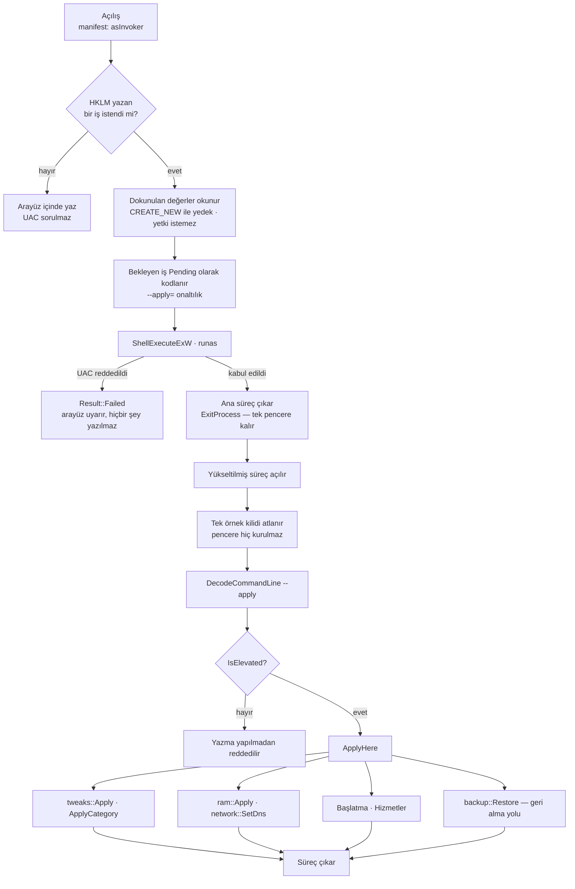

Kodlama tek yönlü değildir: `EncodeCommandLine` → `DecodeCommandLine` gidiş-dönüşü
`test_pure` içinde sınır durumlarıyla denenir. `--apply=` bayt dizisi **kullanıcı girdisi
sayılmaz** ve yine de katı ayrıştırılır: geri alma klasörü adında yalnızca rakam ve tire
kabul edilir, kategori indeksi sınırdışına çıkarsa tüm çözme başarısız olur.

---
## Derleme

```bat
build.bat
```

Betik Visual Studio kurulumunu bulur (`vswhere` sonuç vermediğinde dizin taramasına düşer),
kaynakları derler ve `third_party/` altındaki arayüz kütüphanesini eksikse klonlar.
Çıktı: `build\TENGRI.exe`. Her aşama tek satırda ilerleme çubuğuyla (`#` dolu, `.` kalan)
yazılır; sonda aşama tablosu gelir — hangi aşamanın ne kadar sürdüğü ve her test paketinin
**kendi özet satırı** orada durur. Rakamlar betikte üretilmez: exenin son satırı
olduğu gibi tabloya geçer.

| Komut | Ne koşar | Aşama |
|---|---|---|
| `build.bat` | uygulama + altı test paketi — CI bunu kullanır | 14 |
| `build.bat app` | yalnızca `build\TENGRI.exe` | 8 |
| `build.bat tests` | yalnızca altı test paketi | 8 |
| `build.bat test disk` | tek paket: `pure` `modules` `license` `write` `update` `disk` | 2–3 |
| `build.bat help` | bu liste | — |

Tek paket kipi de araç setini bulur ve `tweak_keys.h` gerekiyorsa registry tablosunu
yeniler; yani tek bir paketi koşmak için tam derlemeyi beklemezsin. **Ölçülen** (bu
makinede, art arda koşan geçişler): tam geçiş 20,4–23,3 s, yalnız testler 11,9–15,2 s,
yalnız uygulama 11,5 s, tek başına bir test paketi 2,1–3,6 s.

Konsol metni ASCII'dir, ANSI renk kodu kullanılmaz: `cmd.exe` 857 kod sayfasına yazar ve
yönendirilmiş çıktıda kaçış dizileri olduğu gibi görünürdi. Çıkış kodu ilk takılan
aşamada sıfırdan farklıdır; koşan aşama sayısı planla uyuşmazsa da sıfırdan farklıdır —
betik kendi planını denetler, bir aşama kuyruğa düşerse sessiz geçmez. Bu denetim boş
durmadı: `app` kipi bir ara altı test paketini de koşuyordu, tablo **14/8** diye çıkınca
hata ortaya çıktı.

CMake de çalışır:

```bat
cmake -B build
cmake --build build --config Release
```

Not: Uzun yol adlarında CMake'in geçici derleme dosyası sığmayabilir
(`could not be compiled` / `ABI info - failed`). `build.bat` bu sorunu yaşamaz; sorun
uzunluğuysa CMake'i daha kısa bir yolda çalıştır.

**Gereksinimler:** Windows 10/11 x64, *Desktop development with C++* iş yükü olan Visual
Studio, Dear ImGui 1.92+ (`third_party\imgui` alt modülü; betik eksikse klonlar ve
sürümü denetler).

### Derleme sırası

| | |
|---|---|
| 1 | MSVC araç setini bulur (`vswhere`, sonuç vermezse dizin taraması), `vcvars64` çağırır ve `cl` yolun mu diye bakar |
| 2 | `third_party\imgui` alt modülü; eksikse `git submodule update --init --recursive`, sonra `IMGUI_VERSION_NUM >= 19200` denetimi (1.92+; sayısal bakıldığı için `1.92.97` gibi WIP başlıklar da geçer) |
| 3 | `tools\make_version.ps1` → `build\obj\version.h` |
| 4 | `tools\make_tweak_table.ps1` → `docs\tweaks-registry.md` ve üretilmiş anahtar tablosu `build\obj\tweak_keys.h` |
| 5 | Marka varlıkları: `make_icon_from_png.ps1` → `res\tengri.ico`, `make_logo_data.ps1` → `src\gui\logo_data.cpp` |
| 6 | Yazı tipi gömme: `make_font_data.ps1` → `src\gui\font_data.cpp` |
| 7 | `rc.exe` ile `res\tengri.rc` → `build\obj\tengri.res` (ikon + manifest + VERSIONINFO) |
| 8 | `cl` ile `build\TENGRI.exe`. Uygulama çalışıyorsa bağlama adımından önce uyarılır: çalışan exe'nin üzerine yazılamaz, ama betik kendi başına süreç öldürmez — kapatma komutu satırda yazılı durur |
| 9–14 | **Altı test paketi** derlenir ve çalıştırılır — biri bile takılırsa betik `exit /b 1` ile durur. Her paketin çıktısı `build\tobj\<paket>.log`a yazılır, sonra ekrana dökülür; son satırı aşama tablosuna not olarak geçer |

CI'da derlemeden sonra üç denetim adımı daha var: `tools\check_text_encoding.ps1`
depodaki her metin dosyasının geçerli UTF-8 olduğunu ve "iki kez kodlanmış UTF-8" izi
taşımadığını denetler (`.ps1` dosyalarında BOM aranır — Windows PowerShell 5.1 bom'suz
UTF-8'i ANSI okur ve üretilen kaynak yorumları bozuk hâliyle depoya girer),
`docs\tweaks-registry.md` aynı betikle yeniden üretilip yerdeki hâliyle karşılaştırılır,
ve etiket ile exe içindeki `VERSIONINFO` sürümünün aynı olduğu doğrulanır.

---

## Testler

`build.bat` derlemenin sonunda altı paket çalıştırır. Toplam **938 denetim**, 0 hata:

| Paket | Denetim | Kapsam | Gerçek sisteme dokunur mu |
|---|---|---|---|
| `test_pure.cpp` | 361 | i18n tabloları (boyut **+ sıra**), RAM ön ayarları, tweak sözleşmeleri, `.reg` paket gövdeleri ve açma/kapama simetrisi, yetki yükseltme komut kodlama/çözme gidiş-dönüşü, yedek dosyası adı ayrıştırması ve içerik kapısı (alt ağaç hoşgörüsü, önek tuzağı, silme biçimi), `TENGRI_SHOT` örnek veri kipi | Hayır — saf mantık |
| `test_modules.cpp` | 44 | Geri yükleme noktası sonuç metinleri, hizmet beyaz listesi güvenlik kapısı, hizmet ve başlangıç sorguları, shader taraması | Hayır — beşi de salt-okunur |
| `test_license.cpp` | 22 | `license::Mask` çırpısı ve grup konumları, `sys::Hwid` determinizması ve biçimi, "beni hatırla" kalıcılığı | Hayır — izole APPDATA |
| `test_write_paths.cpp` | 83 | Shader ve geçici dosya temizleyicilerinin tarama/temizleme tersinirliği, yedek kök dizini + listeleme/en-yeni sıralaması, **üretilen gerçek `.reg` dosyalarının içerik kapısından geçmesi**, kodlama çözümlemesi (UTF-16LE/BOM/UTF-8) ve içe aktarmayı reddetme yolları | Hayır — izole ortam, içe aktarma hiç koşmaz |
| `test_update.cpp` | 170 | Üç parçalı sürüm karşılaştırması, `latest.json` ayrıştırması (eksik/bozuk/taşkın alanlar, sınırda boyut), adres kilidi `HostAllowed` (şema, nokta sonu, alt alan, kullanıcı adı tuzağı), SHA-1/SHA-256 akış hesaplayıcısı bilinen vektörlerle, takas planı ve zamanlayıcı/24 saat matematiği | Hayır — **ağ istemi yok**, döngü içi istek de yok |
| `test_disk.cpp` | 258 | $MFT kayıt ayrıştırması (ikametli ve sakin `$DATA`, run listesi, ölçülen stride ve ofsetler, boyutu okunamayan dosya), `$SDS` sahip sözlüğü, önbellek gidiş-dönüşü ve red yolları (imza, sürüm, sınır dışı indeks, kırpılmış gövde), paralel dilim planı, treemap yerleşimi ve uç boyutlar, UTF-16/UTF-8 dönüşümleri, canlı yürüyüş: döngü koruması, ad alanı tercihi, sert bağlantı adı, tahsis tutarlılığı, yeniden tarama iptal yarışları, önbellek tasfiyesi ve varsayılan iş parçacığı sayısı | Hayır — yürüyüş testleri **yalnızca `%TEMP%` altında kendi kurduğu ağaçta** koşar; gerçek `$MFT` okunmaz, Geri Dönüşüm Kutusu'na dokunulmaz |

**i18n'de boyut denetimi yetmez.** `test_pure`, blok tablolarının birbirine göre
*kaymasını* da denetler (`TweakDescs - TweakNames`, `NetNames - TweakDescs`, toplam tweak
sayısı = 80). `static_assert` yalnız uzunluğu gördüğü için 1.2.0'daki kaymayı
yakalamamıştı. Aşağıdaki [i18n tabloları](#i18n-tabloları) bölümünde o tuzak anlatılıyor.

**Paketlerin hiçbiri gerçek registry'ye, gerçek `%APPDATA%`'ye, gerçek hizmetlere veya
kullanıcı dosyalarına yazmaz.** Testler `SetEnvironmentVariable` değil `_putenv_s`
kullanır: CRT, `getenv`/`_dupenv_s` çağrılarında kendi ortam anlık görüntüsünü okur ve
Win32 API bu anlık görüntüyü tazelemez. Anlık görsel düzeltilmeden yazılmış bir
izolasyon **sessizce başarısız olur** ve gerçek kullanıcı verisine dokunur — bir kez
yaşandı, o yüzden artık her izolasyon testinin kendi ortam değişkenini geri okuyan bir
denetimi var.

Ayrıca `restore::CreatePoint`, `startup::Remove`, `services::SetStartType` ve
`backup::Restore` testlerden **kasıtlı olarak** dışarıda: dördü de geri alınamaz ya da
paylaşılan sisteme yazan eylemler. Bu yüzeyler testlerde yalnızca reddedilme
koşullarıyla (yetki yok, hedef yok, liste dışı ad, `.reg` içermeyen klasör) denenir.

**Kodla doğrulanamayan yollar.** Yükseltme devri (`asInvoker` → `runas` → iş → çıkış) ve
geri alma adım adımı elle denenecek olarak kaldı; adımlar
[`docs/TEST-YUKSELTME.md`](docs/TEST-YUKSELTME.md) içinde — otomatik testler süreçler
arası gerçek UAC çağrısını çalıştıramaz ve gerçek registry'ye yazamaz.
Dışa aktarım tarafı 1.7.0'dan beri otomatik: `test_write_paths` üreticinin **gerçek**
`.reg` dosyalarını çıkartıyor, hepsini içerik kapısından geçiriyor ve sayıyı çıktıda
yazıyor. Geri alma yazma yoluna **hiç dokunmuyor** — `regwrite::Apply` testlerde
çağrılmaz, çağrılsa gerçek registry'ye yazardı. Güncelleme
modülünde de WinHTTP'nin kendisi test dışı: `test_update` ne gerçek ne de döngü içi bir
bağlantı açar, ağ katmanının üstünde kalan her şey (karşılaştırma, ayrıştırma, adres
kilidi, özeti hesabı, takas planı) sahte girdilerle denenir. Gerçek indirme + doğrulama
+ takas yolu, yayınlanmış `TENGRI.exe` üzerinde elle uçtan uca yürütüldü.

### Oyun profilleri: gidiş-dönüş sondası

`test_pure` registry'ye yazmaz, o yüzden `.reg` gövdelerinin gerçekten işe yarayıp
yaramadığını ölçemez. Bu boşluğu `tools/probe_game_tweaks.cpp` doldurur. Her ayar için
beş adım yapar:

1. Geliş bölümünü oku — hangi değerler nerede duruyordu?
2. `regpack::Body(cat, i, true)` ile ayarla
3. **Her değeri `RegQueryValueExW` ile gerçekten sorgula.** Yazma çağrısı başarıyla
   dönse bile yanlış anahtara yazılmış bir gövde sessizce geçer; bu yüzden sorgu ayrı bir
   adımdır.
4. `regpack::Body(cat, i, false)` ile geri al
5. **Geri almayı doğrula** — her değer ya silinmiş ya da belgelenmiş varsayılana dönmüş
   olmalı; hiçbir şey yapmayan bir gövde de başarısız sayılır
6. Geliş bölümünü **aynen geri yük**; kullanıcının özel ayarları sonda ezilmez

```bat
:: derle (komut build.bat içindeki yorumda), sonra YÖNETİCİ olarak:
build\probe_game_tweaks.exe --all       :: kategoriler 4..9, 336 denetim
build\probe_game_tweaks.exe             :: yalnız oyun profilleri (7..9)
build\probe_game_tweaks.exe --cat 8     :: tek kategori
build\probe_game_tweaks.exe --keep      :: geri alma YAPMA (dikkatli)
```

**Oyunun kurulu olması gerekmez.** IFEO (`Image File Execution Options`) anahtarları
exe'yi adıyla tanır; `cs2.exe` diskte yoksa Windows anahtarı yine okur, yalnızca hiçbir
süreçle eşleştirmez. Bu yüzden Valorant/Fortnite/CS2 kurulu olmadan yazma-doğrulama-
silme zinciri baştan sona denenebilir.

Bu sonda bulunan ve düzeltilen hatalar:

| Hata | Sonuç |
|---|---|
| `CryptGenRandom(0, ...)` — NULL "varsayılan sağlayıcı" **değildir**, `ERROR_INVALID_PARAMETER` (87) döner | `Import` geçici dosyayı hiç yazmadan `false` dönüyordu; **bütün regpack kategorileri hiçbir zaman registry'ye ulaşmıyordu** |
| `CREATE_NEW` + `FILE_FLAG_OPEN_REPARSE_POINT` geçersiz kombinasyon (yine 87) | Aynı sonuç: dosya açılmıyor, içe aktarma hiç denenmiyor |
| Gecikme[6] geri alma gövdesi `IRPStackSize` değerini atlıyordu | Ayar kapatılınca `0x20` geride kalıyordu |

---

## Sürümleme ve kimlik

Tüm ürün kimliği — ad, pencere sınıfı, tray metni, `%APPDATA%` klasörü, `Run` değer adı,
geçici dosya öneki, ikon kimliği, bağlantılar — **`src/brand.hpp`** içinde. Yeniden
markalamak tek dosyalık bir düzenleme.

**Sürüm tek yerde yazılır: `src/brand.hpp`.** `tools\make_version.ps1` her derlemede
`build\obj\version.h` üretir, `res\tengri.rc` onu include eder. Böylece `VERSIONINFO`
kaynağı kaynak koddan ayrılamaz. Bu bir kazara yapıldı: bir etiket `v1.0.1` için atıldı,
kaynak kodu `1.0.0` diyordu ve sürüm ancak derledikten sonra fark edildi.

Hakkında sayfası sürümü ikinci bir kopya taşımak yerine `GetFileVersionInfo` ile çalışan
exe'den geri okuyor. Kod tabanında hiçbir yerde derleme tarihi gömülü değil.

`res\tengri.ico`, `tools/make_icon_from_png.ps1` ile `res\tengri-logo.png`'den üretiliyor.
Tek sanat kaynağı bu PNG: pencere simgesi, görev çubuğu, tepsi ikonu, giriş ekranı,
kenar çubuğu ve açılış ekranı hep aynı dosyadan gelir, böylece marka tek yerde
değiştirilir ve hiçbir yerde ayrışamaz.

---

## Mimari

Üç katman, tek yönlü bağımlılık. `core/` hiçbir zaman `app.cpp`'yi ya da `gui/`'yi
tanımaz; yön yalnızca yukarı doğrudur.

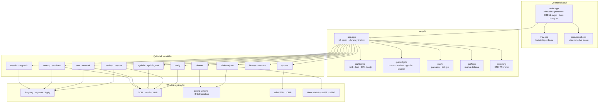

### Kare döngüsü

Ana döngüde **iki çizim vardır ve ikisi de aynı ImGui bağlamını, aynı D3D11 aygıtını
kullanır.** Sıra önemli: önce ana pencere kendi karesini yürütür
(`NewFrame → Render → RenderDrawData → Present(1,0)`), **adanın karesi sonra** gelir.
Adanın `NewFrame`'i bağlamın tek girdi kuyruğunu boşalttığı için, ada önce çizseydi ana
pencerenin yeni `WM_LBUTTONDOWN/UP` olayları adanın karesinde tüketilir ve uygulama
tıklanamaz olurdu. Ada kendi sunumunu `Present(0,0)` ile yapar: tur zaten ana pencerenin
dikey eşitlemesiyle ~60 karede bir tutuluyor, ikinci bir bekleme turu ~30 kareye
düşürürdü. Pencere örtülü ya da tepsideyken çizilen tek kare adanındır.

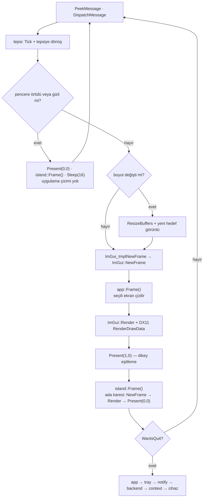

> **Tek bağlam, tek aygıt kuralı.** Dear ImGui'nin "geçerli bağlamı" ve DX11/Win32
> backend'lerinin durum blokları **tekil**dir. İkinci bir `CreateContext` ya da ikinci bir
> `ImGui_ImplDX11_Init` çağrısı bunları ezer: ana pencere adanın bağlamında çizilmeye
> başlar (siyah ekran), ada kapatılınca `Shutdown` ana pencerenin kaynaklarını serbest
> bırakır (`0xC0000005`). Bu yüzden ada yalnızca kendi **swap zincirini** paylaşılan
> aygıt üzerinde açar; `island::SetSharedD3D` bunun tek giriş noktasıdır.

---

## Proje yapısı

```
src/main.cpp                 Kenarlıksız Win32 penceresi, D3D11 aygıtı, yuvarlatılmış köşeler
src/brand.hpp                Ürün kimliği: ad, yollar, registry anahtarları, sürüm, bağlantılar
src/app.cpp                  10 ekran, durum yönetimi, Başlatma, Hizmetler ve Disk Analizörü sayfaları
src/tray.cpp                 Kabuk tray ikonu, TaskbarCreated kurtarması, balon
src/gui/theme.cpp            Renkler, fontlar, DPI ölçekleme (tipografi ölçeği theme.hpp'de)
src/gui/fx.cpp               Parçacıklar, yıldız geçişi, üst ışık, ışık süpürme
src/gui/widgets.cpp          Buton, anahtar, onay kutusu, giriş, kaydırıcı, segment, grafik, bildirim
src/gui/icons.cpp            Vektör ikonlar — GitHub silüeti istisna: küçük boyutta doku olarak çizilir
src/gui/logo.cpp             Marka görsellerini D3D11 dokusuna çevirir: uygulama logosu + GitHub silueti
src/gui/logo_data.cpp        Logonun gömülü baytları — make_logo_data.ps1 üretir
src/gui/brand_icons.cpp      GitHub silüeti — üretilmiş üçgen yedeği ve gömülü yumuşatılmış alfa maskesi
src/gui/font_data.cpp        Alt kümelenmiş Inter'ın gömülü baytları — make_font_data.ps1 üretir
src/core/cleaner.cpp         Dosya taraması ve silme, shader alt-maskesi
src/core/tweaks.cpp          10 tweak kategorisinin registry okuma/yazma işlemleri
src/core/regpack.cpp         Gömülü .reg gövdeleri — bellekte çözülür, dosya açılmaz
src/core/regtext.hpp         .reg okuma + içerik kapısı: ad ayrıştırma, kodlama çözümü, anahtar alt ağacı denetimi
src/core/regwrite.hpp        Registry'ye yazan TEK yer: RegCreateKeyExW + RegSetValueExW/RegDeleteValueW
src/core/ram.cpp             SvcHostSplitThresholdInKB profilleri
src/core/network.cpp         DNS geçişi, adaptör bilgisi, ağ anahtarları, ICMP ölçümü
src/core/sysinfo.cpp         CPU / RAM / disk / çalışma süresi / HWID
src/core/sysinfo_detail.cpp  Secure Boot, sanallaştırma, BIOS modu, kurulum tarihi
src/core/sysinfo_wmi.cpp     WMI sorguları (RAM hızı/yuvaları, TPM)
src/core/sample_data.hpp     TENGRI_SHOT=1: tanıtıcı alanları sabit örnekle değiştirir; örnek etiketlerin gerçek registry'ye yazması engelli (başlık-dosyası)
src/core/lang.cpp            İngilizce / Türkçe metin tabloları
src/core/license.cpp         Demo lisans ekranı, HWID ve Mask
src/core/elevate.cpp         Yetki yükseltme: runas ile yeniden başlatma, komut satırı kodlama
src/core/syspath.hpp         Alt süreçlere giden System32 tam yolu (yalın ad araması kapanır)
src/core/backup.cpp          Uygulama öncesi registry yedeği (kendi dışa aktarım üreticisi) ve geri alma (içerik kapısından geçmiş dosya)
src/core/startup.cpp         10 başlangıç kapsamı; devre dışı bırakmak = HKCU yedeğine taşımak (dosya girdileri taşınır), Winlogon salt-okunur
src/core/services.cpp        16 hizmetlik beyaz liste, başlangıç türü, oyun profili + yedeği
src/core/restore.cpp         Sistem geri yükleme noktası API'si (SRSetRestorePointW, throttling)
src/core/notify.cpp          Windows bildirimleri: WinRT toast, AUMID kurulumu, komut ayrıştırma
src/core/update.cpp          Sürüm denetimi: WinHTTP, latest.json, SHA-256 kapısı, indir + doğrula + takas
src/core/diskanalyzer.cpp    Disk analizatörü: $MFT okuma (dilim paralelliği), $SDS sahip sözlüğü, yürüyüş motoru, treemap yerleşimi, önbellek (TGDS v3), IFileOperation ile silme
res/tengri.rc                İkon, manifest, VERSIONINFO
res/app.manifest             Yürütme düzeyi, DPI farkındalığı, işletim sistemi uyumluluğu
res/tengri-logo.png          Tek sanat kaynağı — ikon, logo ve tepsi hep buradan
res/github-mark.png          GitHub silüetinin 32 px alfa maskesi — make_brand_icons.ps1 üretir
tools/make_version.ps1       brand.hpp'den sürüm başlığı üretir (VERSIONINFO kaynağı)
tools/make_tweak_table.ps1   tweaks.cpp + regpack.cpp'den registry tablosu ve anahtar başlığı üretir
tools/make_icon_from_png.ps1 PNG kaynaktan çok boyutlu .ico üretir — build.bat bunu kullanır
tools/make_icon.ps1          Eski yol: elmas markayı koddan çizen .ico (yedek, build.bat bunu çağırmaz)
tools/make_brand_icons.ps1   GitHub silüetini üçgenler; aynı konturdan 32 px alfa maskesi üretir ve ikisini brand_icons.cpp'ye gömer
tools/make_font_subset.ps1   Inter arşivinden çizilen glifleri alt kümeler
tools/make_font_data.ps1     Alt kümeyi gömülü C++ kaynağına çevirir
tools/make_logo_data.ps1     Logo PNG'sini gömülü C++ kaynağına çevirir
tools/check_text_encoding.ps1  Her metin dosyasını UTF-8 saflığına karşı denetler — CI kapısı
tools/check_workflow_syntax.ps1  İş akışı dosyasını ayrıştırılıp ayrıştırılamadığına karşı yoklar
tools/probe_mft_engine.cpp   Gerçek $MFT üzerinde tarama motorunu koşan sonda: süre, düğüm, kapsam, sahip ve bayrak dökümü
tools/_run_probe_matrix.ps1  Sondayı 1/2/4/8 iş parçacığında iki geçişle koşturur — iş parçacığı tablosunun kaynağı
tools/verify_checkpoint1.ps1  Altı test paketini + $MFT matrisini koşturur, kapsam ve kazanç eşiklerini denetler, rapor yazar
tools/capture_all.ps1        docs/screenshots altındaki bütün görselleri tek oturumda üretir (TENGRI_SHOT=1 ile)
tools/shoot.ps1              Ekran görüntüsü alma yardımcısı (capture_all bunu kullanır)
tools/shrink.ps1, zoom.ps1   Görsel küçültme / bölgesel yakınlaştırma (gözle kontrol)
tools/normalise_type_scale.ps1  Sabit font boyotlarını theme.hpp ölçeğine taşıyan tek seferlik göç betiği
tools/_health.ps1, _probe.ps1   Geliştirme sırasındaki tek seferlik teşhis betikleri
tests/test_pure.cpp          Registry'ye dokunmayan saf mantık — 361 denetim
tests/test_modules.cpp       restore/startup/services/shader yüzeyleri, salt-okunur - 44 denetim
tests/test_license.cpp       HWID, Mask ve kalıcılık (izole APPDATA) — 22 denetim
tests/test_write_paths.cpp   Yazma yolları, tamamen izole ortam değişkenlerinde — 83 denetim (+ gerçek yedeklerin kapıdan geçmesi)
tests/test_update.cpp        Sürüm karşılaştırma, bildirim ayrıştırma, adres kilidi, özet, takas planı — 170 denetim (ağ istemi yok)
tests/test_disk.cpp          $MFT ayrıştırma, $SDS sahipliği, önbellek kapıları, treemap, canlı yürüyüş (%TEMP% dışında hiçbir yere dokunmaz) — 258 denetim
build.bat                    Tek giriş noktası: üret + derle + altı test paketini çalıştır
CMakeLists.txt               Alternatif derleme (test hedefleri yok; testler build.bat'ta)
publish.bat                  Yerel yayınlama yardımcısı
third_party/imgui            Dear ImGui (submodule)
.github/workflows/           Etiket itildiğinde sürümü temiz kurulumda derleyip yayınlar
docs/tweaks-registry.md      80 anahtarın dokunduğu registry yolları (üretilmiş)
docs/TEST-YUKSELTME.md       Elle test listesi: yükseltme devri ve yedekleme/geri alma
docs/screenshots/            Arayüz görselleri (capture_all.ps1 üretir)
docs/release-notes/          Sürüm notları (sürüm başına bir dosya)
SECURITY.md                  Antivirüs uyarıları ve güvenlik bildirimi
CONTRIBUTING.md              Katkı rehberi (derleme, neyi nereden değiştirmek, geri alınabilirlik)
NOTICE.md                    Üçüncü taraf lisansları (ImGui, Inter) ve "AS IS" ayrımı
```

> **`src/core/restore.cpp` derleniyor ama arayüzden bağlı değil.** Sistem geri yükleme
> noktası oluşturmak 10-30 saniye süren, yetki isteyen ve Windows'un 24 saat
> kuralına tabi bir iş; düğmesiz bırakıldı. Modul ve testi hazır, çağıranı yok.
> README bu yüzden "geri alma" bölümünde Windows noktasını **elle** oluşturmanı
> söylüyor — aracın otomatik yaptığı bir şeyi yapıyormuş gibi yazmaz.

### i18n tabloları

`src/core/lang.cpp` aynı uzunlukta olmalı olan iki konumsel metin tablosu tutuyor —
İngilizce ve Türkçe. C++ bunu çalışma anında zorlamıyor, bu yüzden eksik bir giriş çok
sonra tek bir ayarın yanlış etiketi olarak ortaya çıkıyor. Üç `static_assert` tabloları
`S::_COUNT`'a ve birbirine karşı kontrol ediyor, yani uyumsuzluk bir build hatası.

Blok tablosu başlangıcı sabit bir sayı değil, son düz anahtardan türetiliyor. Sabit bir
sayı bir kez kaymıştı ve her tweak etiketini sessizce kaydırmıştı; türetilmiş olması, bir
anahtar eklemenin blokları bozamaması anlamına geliyor.

**Boyut denetimi sırayı denetlemez.** Bu tuzak 1.2.0'da yaşandı: yeni anahtarlar tabloya
`SystemLocale`'dan sonra, enum'a ise `LicenseShort`'tan sonra eklenmişti. Tablo boyutu
`S::_COUNT`'a uyuyordu, üç `static_assert` sustu, derleme temiz çıktı — uygulama 224 metni
yanlış gösterdi (balon "License" yazdı, RAM yuvaları "Windows notifications").

Sonuç: **bir anahtar eklerken enum girdisiyle tablo girdisini aynı yere koy.** Kaymanın
nerede başladığını teşhis etmek zorunda kalmasın diye `src/core/lang.hpp` içindeki ilgili
blokta bu gerekçe yazılı.

**Uygulama doğruyken üretilen tablo yanlış olabilir.** 1.2.0'da ikinci bir kayma daha
yaşandı ve bu sefer C++ tarafı tamamen temizdi: `tools\make_tweak_table.ps1`, `FlatEnd`
değerini enum metninden sayarak buluyor. Yeni sekmelerin üzerine yazılan bir yorum cümlesi
"… FlatEnd'den hemen önce olmalı …" diyordu; satır-sonu çoklu-modu kapalı neredeyse-tam
açgözlü eşleşme yorum atıldıktan *sonra* değil önce çalıştığı için aramayı o sözcükte
bıraktı ve sonradan eklenen 44 anahtar hiç sayılmadı. `docs\tweaks-registry.md` 56 etiketin
tamamını iki satır geriden okudu — uygulama ise doğru çizdi, çünkü o enum'u derleyiciye
çözdürüyor. CI da yakalamadı: denetim adımı dosyayı aynı betikle yeniden üretip
karşılaştırdığı için iki taraf birlikte kaymıştı.

Betik artık iki bağımsız yoldan sayıyor ve uyuşmazlıkta **hata verip duruyor**: enum
metninden (yorumlar düşüldükten sonra) ve `lang.cpp`'deki `---- TweakNames ----` ayracına
kadar olan dize literallerinden. Bir dahaki sefere kayma üretilemez, yalnızca patlar.

---

## Notlar

Operasyonel sınırlar (yeniden başlatma, Windows sürümü, yalnız x64) artık
[Bilinen sınırlamalar](#bilinen-sınırlamalar) bölümünde. Burada projenin duruşu kaldı:

- Bazı ayarların etkili olması için yeniden başlatma gerekir.
- Lisans ekranı bir **demodur**: her anahtar kabul edilir, sunucuya karşı hiçbir doğrulama
  yapılmaz. Ayarlar → Hesap kartı bunu açıkça söylüyor; Hakkında sayfasında plan
  hücresi de aynı demo durumunu gösterir.
- Makine parmak izi, bilgisayar adı, sistem birim seri numarası ve bir **ürüne özgü tuz**
  üzerinden FNV-1a özeti olarak hesaplanır. Yalnızca ekranda maskelenmiş halini görürsün;
  hiçbir isteğe eklenmez. Uygulamanın ağa çıkmasının tamamı
  [Ağ kullanımı](#ağ-kullanımı) bölümünde listeleniyor ve hiçbir satırında HWID yok.
- Bazı anahtarlar birden fazla ayar tarafından paylaşılır (aynı registry değerini ikisi de
  yazar). Uygulama birini kapattığında açık olanın değerini yeniden yazar, ama bu ilişki
  elle tutulan bir listede durur — yeni bir ayar eklerken
  [CONTRIBUTING.md](CONTRIBUTING.md) bunu anlatıyor.

## Sürüm etiketi ve yayın

Sürüm vermek için tek bir yer değişir, sonra etiket:

```bat
:: src\brand.hpp içindeki kVersionMajor / kVersionMinor / kVersionPatch / kVersion
:: (üç parça birleşik sürümle uyumlu olmalı, yoksa make_version.ps1 derlemeyi durdurur)

git commit -am "Surum 1.3.1"
git tag v1.3.1
git push origin main v1.3.1
```

GitHub Actions etiketi görünce temiz bir kurulumda derleyip `build\TENGRI.exe`'yi
`Releases` sayfasına sürer. Başlık her zaman `TENGRI <etiket>` biçimindedir; açıklama
olarak `docs\release-notes\<etiket>.md` dosyasını bulursa onu, bulamazsa `Sürüm <etiket>`
yazıyor.

Aynı iş akışı exe'nin SHA-256'sını, boyutunu ve sürümünü `build\latest.json` içine
yazar ve **ikinci bir varlık** olarak sürer. Uygulamanın sürüm denetimi bu dosyayı okur;
bu yüzden iki varlıktan biri eksikse akış **hata verip durur** — sessizce yarım yayın
yok. Özetin exe ile aynı varlıkta taşınmaması önemli: aynı adrese iki ayrı dosya
geldiği için, indirmenin bozulması veya adresin başka bir şeye çevrilmesi ayrışıyor.

İş akışı, etiketteki sürüm ile exe içindeki `VERSIONINFO` sürümünün aynı olduğunu da
kontrol eder — sürüm kaynağı artık tek olduğu için bu, son savunma hattıdır. Betiğin
kendisi de exe'in kaç KB olduğunu derleme günlüğüne yazar, böylece README'deki boyut
rakamı tahmin değil ölçüm olur.

---

## İstatistikler

<div align="center">
  <a href="https://github.com/Memati8383">
    
  </a>
  <a href="https://github.com/Memati8383">
    
  </a>
  <a href="https://github.com/Memati8383/Tengri">
    
  </a>
</div>

## Lisans

[MIT](LICENSE) — Copyright (c) 2026 TENGRİ Project.

Lisans metni bilerek **düz MIT gövdesidir**, sonuna hiçbir ek bölüm
yazılmadı: GitHub lisans dedektörü dosyanın bilinen bir lisansla birebir
eşleşmesini bekliyor, araya üçüncü taraf bildirimleri girdiğinde algılama
kayboluyor. ImGui ve gömülü Inter yazı tipi ayrısı kendi dosyasında:
**[NOTICE.md](NOTICE.md)**.

MIT'in "AS IS" cümlesi bu projede formalite değil: uygulama registry'ye yazar,
`powercfg` / `netsh` / `sc` çağırır ve hizmet yapılandırmasını değiştirir. Ne yaptığı, ne
yapmadığı ve neden antivirüslerin bunu işaretlediği [SECURITY.md](SECURITY.md)
içinde.